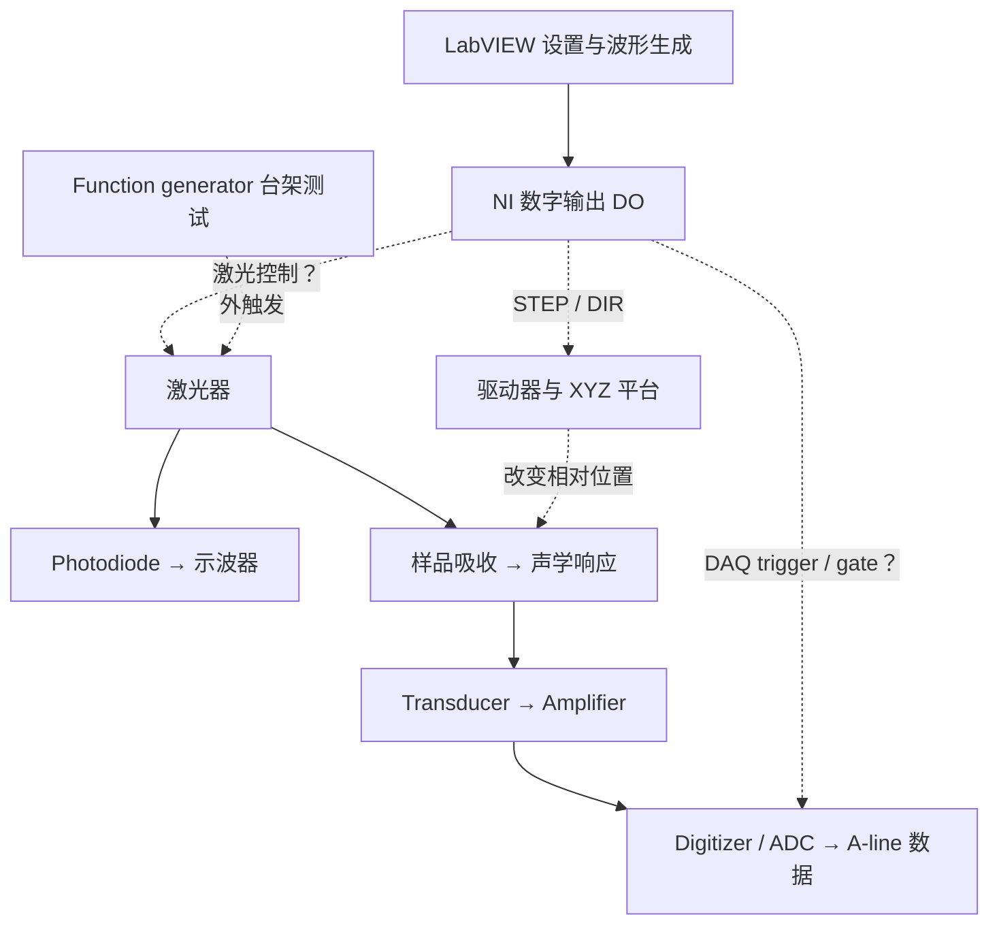

# PAM：理解现有系统与 meeting 准备

更新：2026-09-23。中文为主，附关键英文表达。

当前目标：解释现有设置下的控制、信号与数据流程，并完成一个能区分问题来源的小验证；不是现在重写整套系统。

English: Explain the current configuration, distinguish commanded events from measured hardware responses, and complete one discriminating test before redesigning the system.

## 0. 使用范围与证据等级

本记录采用你上传的 `research-progress`（科研推进与导师沟通）方法：解释 → 预测 → 验证 → 记录 → 讨论。其 `references/templates.md` 未随附件提供，因此本次会议格式根据 skill 正文整理，不声称来自缺失的模板。安装暂未完成，补齐需要你的确认。

- **本轮核对**：本次直接读到的附件、设备手册或计算。
- **历史记录**：过去的用户观察或对话分析；不代表今天仍是同一接线、参数或程序版本。
- **条件计算**：只有列出的假设成立时才适用。
- **待测/待确认**：缺少当前完整数据、接线或程序证据。

本轮没有运行 LabVIEW、操作仪器或采集新的实验数据；旧 CSV/完整 DO 数组没有随这轮附上。

### 对旧项目总结的两处重要更正

1. **`dX=100` 后移动约 1 cm，不构成已证实的换算矛盾。** 历史原始报告是 `Xn=200` 的整行 B-scan：`dX=100` 总行程约 1 cm，`dX=200` 总行程约 2 cm。如果每间隔发出 dX 个 STEP，且每 STEP 约 0.5 µm，那么 `(200−1)×100×0.5 µm = 9.95 mm`，`(200−1)×200×0.5 µm = 19.9 mm`，均与粗测相符。旧总结将整行位移误当成单次步进来比较，这一点应撤回。
2. **项目目标 UV-PAM 不等于当前测试激光器一定是 UV。** 历史记录中的 NPL45C 在制造商手册中是 450 ± 10 nm 的可见光激光器，非紫外；其内部触发为 No，最大触发频率为 50 kHz。要区分长期 UV-PAM 目标、现阶段台架验证和最后成像用激光器。[Thorlabs NPL 用户手册，Rev. J，第 5 页，镜像 PDF](https://device.report/m/79ee6973c5a56a533b606ee3294ca723385b3257f84c3df249af60f8d159f74b.pdf)

上述行程一致性支持当前换算理解，但还不足以证明所有扫描模式都一一对应，也不能用尺量约 1 cm 的结果证明 1 µm 定位精度。

## 1. 导师要求：现在、下一阶段、长期

| 层级 | 目标 | 什么可以成为进展证据 |
|---|---|---|
| 现在 | 能解释当前设置；推进 A-line 信号与噪声定位 | 带设置的波形、测量点、计算、排除的原因、明确的不确定项 |
| 下一阶段 | 按目标改变速度、步距和采集安排，并验证结果 | 改动前预测与改动后实测一致，数据可追溯到位置 |
| 长期 | 独立集成扫描成像并开展组织学/虚拟染色验证 | 标定、图像质量、重复性及匹配数据验证 |

“系统图、参数表、一次排查记录、具体问题”是本次辅助准备方案，不是新增的导师硬性作业；不虚构截止日期。失败但排除了一个原因的实验也能汇报。

## 2. 先把三种测试分清楚

| 测试 | 输入与测量位置 | 能回答 | 单凭它不能回答 |
|---|---|---|---|
| 激光检测 / optical verification | 电触发输入和 photodiode 输出，同时用示波器测 | 是否出光、光脉冲周期、相对电触发的检测延迟 | 是否产生/接收到真实 PA 信号；电机实际步距 |
| 控制时序 / command timing | 同次运行的最终 U8 DO 数组；进一步在物理端口测 | 程序安排了哪些 STEP、DIR、laser/DAQ 控制边沿 | 指令是否都被硬件接受；是否掉步；是否真的出光 |
| 声学接收 / acoustic reception | transducer → amplifier → 示波器或 digitizer | 接收波形、噪声、到达时间、样品相关变化 | 仅有触发同步尖峰不能证明它是真实 PA 信号 |

因此，“现在用光电二极管测 laser detection”和“下一步验证 A-line”并不矛盾，它们验证的是不同链路。报告时先说本次是哪一种测试。

## 3. 当前系统控制/信号图：功能关系，不是已确认的接线图

虚线表示仍需本机接线和端口测量确认；实线为功能上的信号路径，并不意味着本轮已经测通。

- Function generator 与 DO 是两种可能的激光触发来源；不表示应把两个输出直接连在一起。
- 如果当前仍在 function-generator 台架测试，不把它与旧 LabVIEW DO 波形拼成一张“实测同步图”。
- 示波器的 CH1/CH2/CH4 是测量通道编号，不等于 DO bit 1/2/4；每次实验都记录各通道所接信号。
- “DAQ”指数据采集功能；本项目中的 NI 控制输出与 Alazar 高速 digitizer 是不同职责，不能看到 DAQ 就混成同一个采样时钟。
- 用于接收的 transducer 是被动换能器；接收放大器是否上电、增益多少、连到哪里需要分别记录。

### 从一次激励到图像

1. 接收采集链路先配置并进入可接收触发状态。
2. 一个有效电触发使外触发激光器产生光脉冲；photodiode 用于确认光输出。
3. 样品吸收光能后可能产生声学响应，经传播、换能和放大后到达 ADC 输入。
4. 采集卡按触发、延迟、记录长度和采样率保存时域波形。
5. 将波形和当前横向位置关联，形成 A-line。一个位置可以有单次或多次激励/平均，取决于程序。
6. 沿 X 组织一组 A-lines 得到 B-scan；多行 XY 数据构成 raster 数据集，可做 C-scan 的指定深度/时间门显示或投影。C-scan 究竟显示什么量，要查数据处理定义。

这里没有假定“每一个 motor STEP 都采一条 A-line”，也没有假定“每一个 laser pulse 都保存一条独立 A-line”。

## 4. 关键参数表：历史值不是今天的已确认值

| 参数 | 已有记录 | 它决定什么 | 当前需核对的证据 |
|---|---|---|---|
| DO sample rate | 500 kS/s；旧说明中也出现过 100 kS/s | 若为硬件时钟输出，决定 DO 数组相邻元素时间 | 同次运行的 DAQmx 时钟配置/实际 rate；不能混用两个值 |
| motor pulse rate | 16 kHz 曾被讨论/设定；旧局部波形分析约 62 µs 间隔 | STEP 边沿速度，结合步距影响移动速度 | 当前 B/C-scan 实际走的生成路径及 STEP 端口间隔 |
| laser/DAQ electrical pulse rate | 旧 DO 记录中 Bit6/Bit7 曾每 5 samples 重复 | 控制脉冲重复速度 | 当前最终数组及物理输出；不等同光脉冲 |
| function-generator rate | 历史台架测试曾用 20 kHz | 对应外触发请求的周期为 50 µs | 同次示波器电触发与 photodiode 波形 |
| ADC sample rate | 历史讨论 100 MS/s | 一条记录内部相邻采样点为 10 ns | digitizer 本次配置/数据头 |
| record length | 历史讨论每条 64 samples | 每条波形的数据长度 | 原始记录维度；是否裁剪/抽取/平均后数值 |
| trigger delay | 历史讨论约 3.5 µs | 记录相对触发的时间位置 | 本次设置、单位与预触发定义 |
| dX/dY | 教授说软件输入无单位；历史行程支持与 STEP 数相关 | 通过生成逻辑影响每个位置间隔的位移 | 每个间隔的 STEP 数与物理行程 |
| Xn/Yn | 历史用来表示每行/行数；具体循环边界需查 | 位置或循环数量，而非频率 | 首尾位置、有效记录数量、外层循环次数 |
| kx/ky/kz | 用户曾观察改变 kx 会变速度和时间，总距离不变 | 说明可能作用于时序；精确关系尚未确认 | 参数连线与受影响波形；不能仅凭名字称为方向系数 |

NI 的 sample clock 定义是：每个时钟 tick 推进一次每通道的采样/生成，因此 DO sample rate 是“波形网格的速度”，不是每条线都以同样频率产生脉冲。[NI：Sample Clock](https://www.ni.com/docs/en-US/bundle/ni-daqmx/page/sampclock.html)

### 候选 DO 映射，保留验证状态

| Bit | 历史记录的逻辑功能 | 本轮限制 |
|---:|---|---|
| 0 / 1 | X STEP / X DIR | 当前端口接线与驱动器有效沿需核对 |
| 2 / 3 | Y STEP / Y DIR | 同上 |
| 4 / 5 | Z STEP / Z DIR | 同上 |
| 6 | DAQ-related control，旧记录称 trigger/enable | 是边沿触发还是电平门控，须查实际接收端配置 |
| 7 | Laser-related control，旧记录称 laser trigger | 是否连到当前激光器以及是否每次有效，须实测 |

`192 = 128 + 64` 只说明该 U8 样本的 bit7 与 bit6 都为 1。要数 pulse，必须数 0→1 转换；连续多个 192 样本可能只是同一个高电平脉冲。

## 5. Motor：为什么动、何时动、多少、多快

在常见 STEP/DIR 接口中，驱动器接收有效 STEP 沿，按 DIR 状态驱动运动。有效沿、电平范围、最短高低电平时间和 DIR 建立时间，以实际驱动器手册为准。

| 问题 | 应解释的量 | 应做的验证 |
|---|---|---|
| 为什么动 | 驱动器收到有效 STEP，轴处于可运动状态 | 当前 STEP 端口与使能状态 |
| 何时动 | STEP burst 的起止和 DIR 状态；机械响应可能滞后 | 同次时序与实际位置响应 |
| 移动多少 | 有效 STEP 数 × 标定步距；受掉步/回差等影响 | 边沿计数加实际位移 |
| 移动多快 | STEP 频率 × 标定步距，适用于跟随良好的移动段 | STEP 周期、运动段持续时间、位移 |

历史手动标定：20,000 pulses → 约 10 mm，所以 `sX ≈ 0.5 µm/pulse`。

条件公式：

\[
\Delta x = P_x s_x,\quad L_x=(N_x-1)\Delta x,\quad v_x\approx f_{STEP}s_x
\]

其中 `P_x` 是相邻采样位置之间实际发出的有效 STEP 数，不是未经核对就直接等同 dX。

- 若 `fSTEP=16 kHz` 且 `sX=0.5 µm/pulse`，移动段速度约为 **8 mm/s**。这不是已经测得的整行平均扫描速度。
- 固定 STEP 总数，仅提高频率：理想总位移不变，移动时间缩短；硬件可能因速度/加速度限制掉步，所以仍要实测。
- 固定频率，增加 STEP 总数：理想位移与移动时间都增加。
- `dX` 和 `Xn` 只提供数量/空间信息，不能单独推出 motor rate；还需要时间信息和实际生成逻辑。
- 软件 Position 显示可能只是命令累计值，不等同独立位置传感器读数。

### 3 mm × 3 mm 的空间计算，暂不作为本轮操作指令

假设 X、Y 均已标定为 0.5 µm/STEP，且目标相邻位置间隔为 10 µm：每间隔 20 STEP，含两端点的 3 mm 需要 301 个位置，即 301×301 网格。若只有 20 个位置，则扫描中心跨度为 `19×10 µm=190 µm`，不是 3 mm。

 nominal 1 µm 指令在这个标定下是 2 STEP；命令分辨率不等于定位精度，用普通尺量厘米行程不能证明微米级重复性。

## 6. 16 kHz、100 kHz 与“6.25”的准确解释

### A. 同一个 DO 时间网格

假设本次硬件 DO rate 为 500 kS/s：

\[
\Delta t_{DO}=2\ \mu s,\qquad t[n]=n\Delta t_{DO}
\]

- 同一路相邻上升沿相隔 5 samples：`5×2 µs=10 µs`，电脉冲频率为 100 kHz。
- 相隔 31 samples：`62 µs`，频率约 16.13 kHz。
- 精确 16 kHz 的周期是 62.5 µs，即 31.25 samples。若 STEP 由此 DO 数组逐点生成，不能用一个固定整数间隔精确表示；可能取整，或按多个周期组合逼近平均值，须查实际数据。
- 如果 STEP 来自独立 hardware counter，则不能把上述 DO 网格限制直接套给它。项目清单同时包含 `SendDOPulses.vi` 与 `SendCOPulses.vi`，不能只凭文件名确定当前分支。

### B. 频率比不是逐步计数

`100 kHz / 16 kHz = 6.25` 是两列假定连续脉冲的平均频率比，不是某次物理动作发出 6.25 个光脉冲。

- 每个明确时间区间内的真实事件数必为整数。
- 两列连续脉冲如果相位在区间边界之间变化，有的区间可能数到 6 个，有的 7 个；这在数学上可能，并非物理不可能。
- 但不能因此宣称本机正按 6/7 脉冲运行。导师质疑的核心是：你是否证实了实际分配和同步方式，而不只是除两个数。
- 如果激励/采集是一个 burst，移动是随后另一个 burst，直接除 burst 内部频率尤其不能得到“每个采样位置的激光数”。

历史分析曾描述过两类局部 buffer：20 个控制触发后接 2 个 X STEP；另一例是 20 个控制触发后接 8 个 X STEP。它们不是今天同一个设置的证明，也不能拼接。它们说明必须先确认 buffer 的范围和采集/移动是否分段。原始数组未附本轮，以上仅保留为历史分析线索。

### C. 如何回答“每个位置/每条 B-scan 有多少 laser pulses”

先定义问题中的“step”：驱动器的一个 STEP，还是相邻两个采样位置之间包含多次 STEP 的移动？

再分别统计：

1. 同一个完整 B-scan 中 bit7 的有效上升沿数：软件激光触发命令数。
2. 对应 photodiode 光脉冲数：实际检测到的光事件数。
3. 实际保存的 acquisition records：采集卡接受并保存的记录数。
4. 按每个位置的采集窗口分组计数：得到每位置的激励和记录数。

条件例：若每个位置确实采 M 次，整行有 Nx 个有效位置，且无额外发光/漏触发，则激励总数为 `M×Nx`。移动的间隔通常为 `Nx−1`；首尾是否有额外动作，须由代码和完整波形核对。

不要在 M、有效位置数、gate、端点行为与当前时序未知时报告 37,500 等旧估算为实测结果。

## 7. A-line：64 点和噪声分别意味着什么

条件：`fsADC=100 MS/s`、每条记录 `Ns=64`。

- 采样间隔：`1/fsADC=10 ns`。
- 名义记录窗口：`Ns/fsADC=0.64 µs`，不是 0.64 ns。
- 第一到最后一个采样点的时间差：`(Ns−1)/fsADC=0.63 µs`。
- 64 点是同一条波形沿时间方向的样本，不是 64 个横向位置，也不是 64 个激光脉冲。
- 激光周期、记录窗口、触发延迟和等待/移动时间是不同的时间量。
- A-line 中的时间还包括触发到出光、声传播和电子链路延迟；不能直接把横轴全部解释成组织深度。

“测到波形”与“确认真实 PA 信号”不同。当前 CH4 的较大波形可能含真实声学响应、电子背景、触发串扰、饱和或环境/耦合问题；没有对照前不诊断。

历史上教授提到背景通常 <10 mV，但测量定义未明确；另有 <50 mV Vpp 的阶段目标。两者不能混称同一标准。每次记录是否为放大器输出端、增益、输入阻抗、带宽、测量时窗，以及 Vpp 和去均值后的噪声 RMS。

## 8. 本轮只安排三项优先行动

以下是建议顺序，不是硬性日期或必须一次完成的清单。A 完成后，B 和 C 可按设备可用情况推进。

### A. 固定一个可追溯的当前配置 / Freeze one configuration

- **问题**：今天究竟是哪种测试，哪个设备发触发？
- **最小操作**：不改参数，保存整张前面板、相关 generator 设置、激光器铭牌、各示波器通道来源与接线说明；给同次运行一个 run ID。
- **预期观察**：同一运行中的 rate、测试模式、测量点能一一对应。
- **完成证据**：一张参数表，未知项明确标为未知，不用旧设置补空。
- **异常分支**：无法追到某根线或无法确认保护/额定设置时，先请受训人员现场确认，不尝试随机连接或提高频率。

### B. 解释一个最终 DO buffer，再验证它在整行中的角色

- **问题**：16 kHz 是否实际用于当前 B/C-scan；激光/采集控制和移动是否分段？
- **最小操作**：沿用已掌握的 Retain Wire Values，保存同次运行最终 `Forward DO Pulse`/发送前 U8 数组和实际 DO rate，不只截前几十个数；标明 probe 位置。
- **记录**：总长度 N；各 bit 上升沿索引；bit0 间隔序列；bit6/7 脉冲数及重叠；输入 dX、Xn、subpixel/averaging 设置；外层调用范围。
- **预期观察**：如果分段，能分别指出 acquisition burst 与 motion burst；如果同时存在，能按实际边沿计数。
- **完成证据**：一张共同时间轴的 bit0/bit6/bit7 图，加一张事件统计表；若是同一个 U8，也可解码全部八路。
- **异常分支**：Xn 改变但小 buffer 相同 → 检查是否外层循环重复，而不是立即判断 Xn 无效；只有初始高电平、前一状态未知 → 首脉冲计数标为边界不确定；间隔变化 → 区分 burst 内周期与 burst 间等待。
- **后续测量**：按已批准的接线方式在物理 STEP/control 端口比较波形；没有这一步时，称为程序命令分析，不称硬件同步已经验证。

独立运行导出的 X/Y 文件，即使 time=0 对齐，也不能证明真实同时发生。需同次采集的公共时间戳、公共触发或其他同步证据。

### C. 对 A-line 接收链路做一个受控比较

- **问题**：主要变化来自接收电子链路，还是与光/样品相关？
- **前提**：先按实验室 SOP 确认 amplifier 正常供电、接线、额定输入和已知增益；保留激光防护与联锁。不拔保护地，不带电试接，不盲接 50 Ω，不随意换 TTL 电平，不用未经批准方式挡光或暴露光路。
- **最小比较**：接收配置保持不变，在合规方式下比较“无光到达样品的背景”与“已知吸收体、有正常光照”的波形；记录触发电子部分在两条件中是否保持工作。
- **固定量**：探头/线缆、输入阻抗、增益、带宽、采样率、触发源、时间窗；保留单次波形，平均结果仅作为附加视图。
- **记录**：同一无信号时窗中的 Vpp、去均值 RMS、波形是否削顶、重复次数；比较有信号窗口的到达时间与重复性。
- **预期观察与分支**：
  - 无光时仍很强：接收电子背景、触发耦合等候选仍在，不能说一定来自组织。
  - 有无样品波形几乎相同：样品 PA 来源尚未确认；空载支架/水/其他吸收体也可能产生响应，不能只凭“无样品”断言纯 EMI。
  - 仅在有吸收体时出现可重复延迟响应：支持样品相关性，但还应验证焦点/位置或声程变化。
  - 波形削顶：先按额定配置排查量程与增益，否则幅度/RMS 的比较不可靠。
- **完成证据**：带测量条件的两组原始波形、同窗噪声数值，以及“支持/仍不能区分哪些原因”的简短结论。

放大器 OFF/ON 比较可按器件正常使用流程作为附加检查，但输出变大本身不等于放大器故障；放大器也会放大输入信号和输入噪声。

## 9. 下次 meeting 的四份材料

| 材料 | 本文已准备 | 需要你补的真实实验内容 |
|---|---|---|
| 1. 系统图与时序图 | 第 3 节功能图；第 6 节时间计算 | 真实接线；一份同次运行的最终波形。未测边沿不填假时间 |
| 2. 参数表 | 第 4 节表格及数值的历史标签 | 本次 settings 截图、单位和 run ID |
| 3. 一次验证/排查记录 | 第 8 节最小对照设计；下方记录模板 | 实际尝试、原始观察、结果与排除范围 |
| 4. 两个具体问题 | 下方提供 | 按本次发现调整，不要求先成功 |

### 记录模板：只填发生过的事

- Run ID / 日期：待填。
- 当前目标与测试种类：待填。
- 本次固定设置和测量位置：待填。
- 改变的唯一条件：待填。
- 事前预测：待填。
- 实际观察与原始文件：待填。
- 目前解释：待填。
- 能排除什么、还不能排除什么：待填。
- 下一次最小测试：待填。

### 当前可用的简短 meeting 发言：不声称新实验已经完成

中文：

我理解当前优先任务是解释现有设置下的系统行为，并推进 A-line 接收及噪声定位。我把软件生成的触发、光电二极管检测到的真实光脉冲、以及换能器接收的波形分开记录。之前用 100 kHz 除以 16 kHz 得到的 6.25，只是一个条件性的频率比，不是逐个电机 STEP 的实测激光脉冲数；我还需要检查当前扫描分支中的 STEP 间隔和采集窗口。接下来我计划保存一组可追溯的设置与最终 DO 波形，并在固定接收配置下完成背景和已知吸收体的对照。

English:

My immediate goal is to explain how the current configuration operates and to investigate the A-line signal and background. I am separating the software-generated trigger commands, the optical pulses detected by the photodiode, and the waveform from the acoustic receiver. The earlier ratio of 100 kHz to 16 kHz is only conditional; it is not a measured pulse count for each motor STEP. I still need to verify the STEP intervals and acquisition windows in the active scan path. My next steps are to save one traceable configuration with its final DO waveform and to compare the background with a known absorber under fixed receiver settings.

### 向导师核对的两个问题

1. “我理解当前先完成现有时序解释和可重复的 A-line/背景对照，再推进 B-scan。这样的阶段划分是否符合您的要求？”
   - “Is it appropriate to first verify the current timing and a repeatable A-line/background comparison, then move on to B-scanning?”
2. “您说的背景 <10 mV，是在放大器输出端、什么增益和带宽下测的 Vpp 还是 RMS？它与之前 <50 mV Vpp 的阶段目标怎样对应？”
   - “For the background target below 10 mV, what measurement point, gain, bandwidth, and metric—peak-to-peak or RMS—should I use?”

这些是草稿，不表示已经发送或安排会议。

## 10. 完整理解项目的学习顺序

| 模块 | 为什么学 | 学到什么算可用 |
|---|---|---|
| 1. 电触发与真实出光 | 建立事件起点 | 能说明 source、trigger edge、photodiode 分别证明什么 |
| 2. DO 网格、STEP 与位移 | 把软件数值对应到动作 | 能从边沿数/间隔预测位移和移动时间，并说出适用条件 |
| 3. 接收与 A-line | 确认光声测量而非只检测光 | 能解释采样率、记录长度、延迟、噪声时窗及对照结果 |
| 4. 位置与数据关联 | 从一条信号走向扫描 | 每条有效记录能对应坐标，知道重复/平均与丢失如何处理 |
| 5. B/C-scan 与质量验证 | 获得可信图像 | 扫描范围、方向、回程、重复性与已知目标相符 |
| 6. Histology 与虚拟染色 | 进入研究应用 | 同切片/配对数据质量和评价标准清楚，不把结构相似当生物标记真值 |

现在优先 1–3，4–6 保留为后续路线，不一口气学完所有知识。每轮只选一条卡住的关系，完成“定义 → 本机位置 → 预测 → 验证”。

简短迁移练习（不必现在答）：若保持 STEP 总数不变而降低 STEP 频率，理想位移怎样变、移动时间怎样变？应答：位移不变、移动时间变长；整行时间还包含采集和等待，实际位移还要检查掉步/回差。

## 11. 附件能支持到哪里

本轮重新检查的 `.lvproj` 列有 `GeneratePulses.vi`、`GenerateDiffPulses.vi`、`GenerateSkipPulses.vi`、`SendDOPulses.vi`、`SendCOPulses.vi`、`ScanXY.vi`、`GetDAQAsyncData.vi`、`ProcessDAQData.vi` 等。清单证明这些依赖被引用，不证明名称对应的函数在当前按钮分支中一定执行。

这些 SubVI 的代码未随本轮提供；`Main.vi` 是二进制 LabVIEW 文件。本轮不能逐节点还原运行逻辑、认定驱动卡确切型号或验证本机硬件行为。`.lvlps` 是工程窗口配置，不是采集参数证据。此前读取的 `scan_pattern.mat` 包含 `177×2000 uint16 sampling_rows`，维度本身不能证明它是当前采样图、当前 DO 时序或有效成像结果。

要继续精确辅导，最有信息量的下一组材料是：同一次运行的前面板和最终 U8 DO 数据，或带 source/量程/时间轴的接收波形。一次先做其中一组，不要求你同时交齐全部文件。
