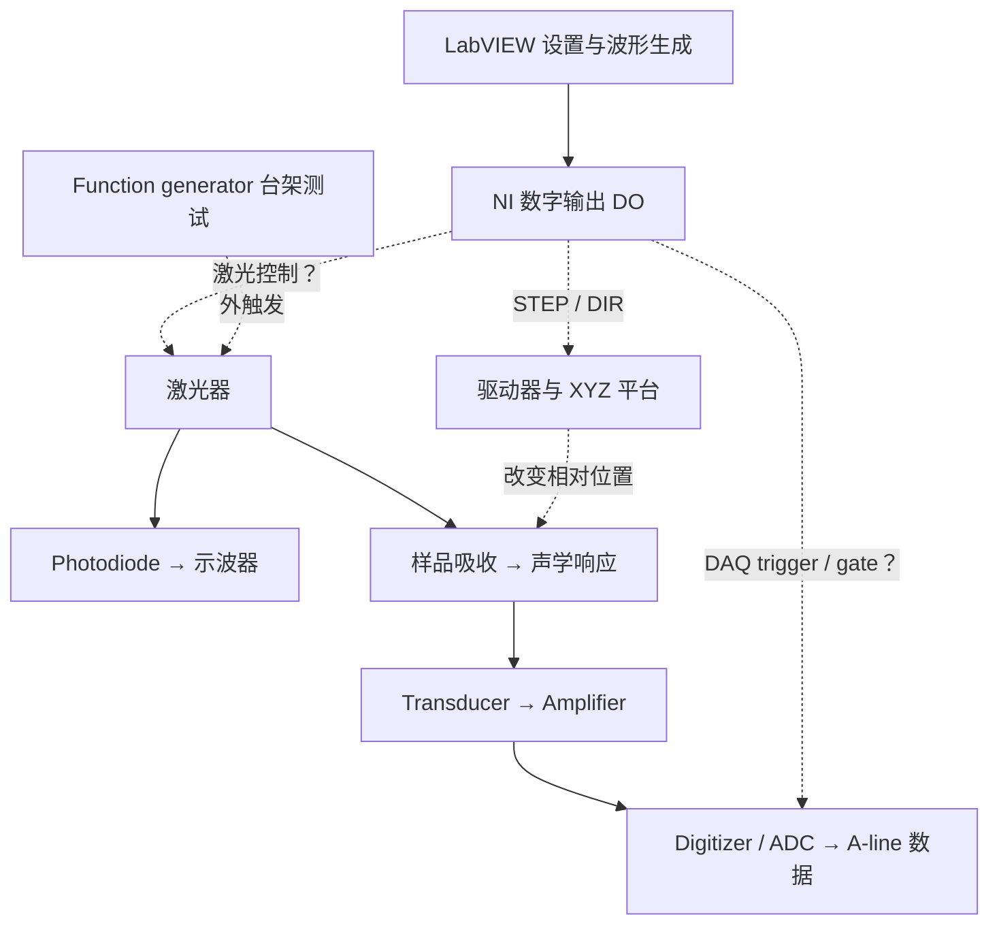

# UV-PAM 项目主记录（master）

> **最近更新**：2026-10-15 · v1.3（§20.1 加 10/15 会后新增 3 问，采集方式一条补 10/15 Rui 的说法；依据 `会谈记录/2026-10-15_Rui来看演示_要点.md`、`06_控制程序/docs/19_100kHz触发设计.md`）。之前：2026-10-13 晚 · v1.2（更正 §19.2 TRIG IN 一条的依据和 G1 设置、§19.3「约 3 s 卡住」、§20.1 trigger 频率与采集方式、§20.2 TRIG IN；依据 bscan_test.m、docs/09、docs/13 §2、SDK 指南 §6.85 与 SDK 示例）。之前：2026-10-13 · v1.1（会后更新 §19、§20：补 9/24–10/12 的进度和 10/12 会谈；依据工作日志、docs/10、docs/13、`UVPAM_Phase1_Weekly_中英对照与解释.md`、`会谈记录/2026-10-12_Rui会谈整理.md`）。之前：2026-09-23 · v1.0（首次合并）
> **这是唯一主文件。** 会后只改 §19「当前进度」和 §20「待确认 / 问 Rui」；冲突有结论先写进 `claude/context-conflicts.md`，再同步到这里；每次改动更新本行日期。
> **来源**（GPT 与 Claude 的内容都保留，只删重复；来源用 ⟨C⟩ = Claude 8/30 版、⟨G⟩ = ChatGPT 9/21 + 9/23 三份、⟨N⟩ = Drive 交接笔记 v0.9 8/07 版 标出）：
> ① `UV-PAM-context.md`（⟨C⟩）② `PAM_project_context_for_new_chat.md`（⟨G⟩ 9/21）③ `PAM_Project_Handoff_2026-09-23.md`（⟨G⟩）④ `PAM_Current_Setup_Meeting_Prep_2026-09-23.md`（⟨G⟩，可复用部分；全文另存 `claude/meeting-prep/2026-09-28.md`）⑤ `PAM_New_Chat_Context_2026-09-23.txt`（⟨G⟩）⑥ Drive `PAM_LabVIEW_交接笔记.md` v0.9（⟨N⟩，9/23 重读核对）
> **当前状态一句话**：系统集成、扫描时序核对、光学/声学信号验证仍在进行。已有运动和软件 DO 波形证据；**不能**把「3 mm × 3 mm 验收完成」「每位置实际光脉冲数已定」「可靠组织 PA 成像已完成」写成事实。

---

## 0 阅读规则与证据等级

| 标记 | 含义 | 可以怎样使用 |
|---|---|---|
| **[文件确认]** | 直接从附件、手册、代码、截图读到 | 只证明文件内容，不自动代表硬件当前状态 |
| **[实测]** | 用户报告过的测量、观察或波形计数 | 保留测试条件；精确复算要回原始数据 |
| **[历史解释]** | 过去根据截图、代码或数据作的解释 | 不能升级成硬件已验证事实 |
| **[导师要求]** | Rui 的目标、问题或验收要求 | 是任务，不代表已完成 |
| **[条件计算]** | 在明确假设下的换算 | 必须和假设一起引用 |
| **[待确认]** | 缺实测、接线或完整程序证据 | **不进计算、不进扫描设计** |

- 新增结果要记：日期、程序版本、运行模式、实际参数、原始文件名、结论适用范围。
- 五件事分开说：**软件生成命令 → 接口上测到的电信号 → 实际出光 → 真实运动 → 成功采集**。生成了命令不等于硬件输出了；bit7 为高不等于激光出光。
- 旧参数不等于当前设置；示例图不能取代当前数据。

**沟通偏好（⟨G⟩ Handoff §22 + 9/21 §1、§16；也写进 project instruction）**：中文解释 + 英文版本或关键英文术语；每个数字说明来自哪组设置、是实测还是例子；优先把当前一个具体疑问讲清楚，尤其 pulse / step / position / sample 的区别；需要图时画有明确时间单位、起止区间、信号来源的时间轴，示例图注明假设；MATLAB 代码配中文注释（数据来源、合并顺序、同步依据）；已完成的观察要保留，缺证据时指出具体缺哪一项，不要求全部重测；不把 photodiode 阶段写成已完成组织声学成像，不把建议当作完成记录；分析 LabVIEW 时没有 SubVI 或实测 DO 输出支持，不凭 Main.vi 猜内部行为。

---

## 1 我是谁 / 项目 / 会议 / 导师三层目标

**Yumeng Chen**，CWRU 生物医学工程博一（Fall 2026），Rui Cao 组。方向：photoacoustic imaging、biomedical optics、breast cancer imaging。⟨C⟩

**当前任务** [导师要求]：先复现实验室的 parallel UV-PAM 系统，跑通后开始扫描。长期：组织成像、同一切片 H&E 对照、虚拟染色（H&E→IHC，将来 UV-PAM→IHC）。⟨C⟩⟨G⟩

**项目背景** [文件确认 ⟨N⟩ §8]：课题 *UV Photoacoustic Microscopy for Label-free and Slide-free Intraoperative Histology*（术中乳腺组织学）。PI **Aparna Harbhajanka**（UH 病理科）；co-investigator **Rui Cao**。样本：福尔马林固定人乳腺组织，最多 100 例；光声组织学 ↔ H&E 交叉验证 + 训练虚拟染色网络。流程：系统 ready（先扫头发/phantom 调形状、对齐、对比度）→ 再扫病理组织。

**固定会议**：周一 9:00 与 Rui 一对一；周五 9:00 Cao lab 组会（BRB 332）。会议用中文。⟨C⟩ + 用户 9/23

**一段话自我介绍（⟨G⟩ 9/21 §15，用于开场/邮件）**
中文：我正在集成和验证一套紫外光声显微镜系统。目前主要工作是同步激光、高速采集卡与 XYZ 光栅扫描，标定脉冲与位移的关系，分析声学噪声并确认真实光声信号，以及实现经过验证的 3 mm × 3 mm 扫描。后续将把 PAM 图像与 H&E 组织学对照，并研究从 H&E、最终从 UV-PAM 数据预测 IHC 的虚拟染色方法。
English: I am integrating and validating a UV photoacoustic microscopy system. My current work focuses on synchronizing the laser, high-speed digitizer, and XYZ raster motion; calibrating pulse-to-distance conversion; characterizing acoustic noise and confirming a real photoacoustic signal; and building a validated 3 mm × 3 mm scan. The longer-term workflow will compare PAM images with H&E histology and investigate virtual IHC staining from H&E and eventually UV-PAM data.

**关键背景** ⟨C⟩：对标论文第一作者就是 Rui Cao 本人（Caltech 王立宏组博后工作，2024-12 Sci Adv），LabVIEW 作者 Yide Zhang 是共同作者。**讲论文参数不要当科普讲，要当提问讲。**

### 1.1 导师的三层目标 ⟨G⟩ Meeting Prep §1

| 层级 | 目标 | 什么算进展证据 |
|---|---|---|
| 现在 | 能解释当前设置；推进 A-line 信号与噪声定位 | 带设置的波形、测量点、计算、排除的原因、明确的不确定项 |
| 下一阶段 | 按目标改变速度、步距、采集安排并验证 | 改动前预测与改动后实测一致，数据可追溯到位置 |
| 长期 | 独立集成扫描成像并开展组织学/虚拟染色验证 | 标定、图像质量、重复性及配对数据验证 |

失败但排除了一个原因的实验也能汇报。不虚构截止日期。

### 1.2 Rui 提出过的目标 [导师要求] ⟨G⟩ Handoff §2

运动：X、Y 两轴 home/reference；nominal 1 µm moves；软件完成 3 mm × 3 mm raster；验证实际行程和返回位置重复性（容差数值未定）。
信号：明确激光电触发、实际光输出、电机 STEP、DAQ trigger/enable、ADC 采样之间的时序；回答每个扫描位置 / 每个 dX 区间 / 整条 B-scan 内有多少激光脉冲和有效记录；transducer/amplifier 链路背景 **< 50 mV Vpp**（明确写出的指标）；black tape 可重复 bipolar signal → 验证光/声焦点与轴向延迟；完成组织学 pilot。
其他 ⟨G⟩：保存八路 DO 完整时间序列；AnyDesk 无法连接要查密码和设置（无修复证据）。

---

## 2 对标文献与验收参数 ⟨C⟩

| 论文 | 用途 |
|---|---|
| **Optical-resolution parallel ultraviolet photoacoustic microscopy for slide-free histology** · *Sci Adv* 10, eado0518 (2024) · DOI `10.1126/sciadv.ado0518` | 直接对标；第一作者 = Rui Cao。付费墙已解决：NSF Public Access 作者接受稿 `https://par.nsf.gov/servlets/purl/10594287` |
| **Multiscale photoacoustic microscopy and computed tomography** · Lihong V. Wang · *Nat Photonics* 2009 · DOI `10.1038/nphoton.2009.157` | 综述；Rui 的博后导师 |

### 论文关键参数（= 复现的验收标准候选）[文件确认]

| 项目 | 论文值 |
|---|---|
| 激发 | 266 nm，50 kHz 重复频率 |
| 并行焦点 | 8 个，间距 375 µm |
| 横向分辨率 | 1.3 µm |
| 扫描步长 | 1 µm |
| Fast axis | 2D galvo GVS412 (Thorlabs)，同时扫全部 8 个焦点 |
| Slow axis | 步进电机 PLS-85 (PI)，最高 10 mm/s |
| 探测 | 2 × focused single-element transducer，34.1 MHz |
| 前放 | 2 × ZFL-500LN+ (Mini-Circuits) |
| 数字化仪 | AlazarTech ATS9350，500 MS/s |
| 控制卡 | NI PCIe-6323 + 定制 LabVIEW |
| 物镜 | 定制 UV F-theta，NA ≈ 0.15 (Avantier) |
| 典型扫描 | 8 mm × 3 mm；0.4 mm²/s = 400k pixel/s = 4.2 min/cm² |

**一个真实差距**：我们的 LabVIEW 跑 legacy ATS-VI 6.3.0，采样率封顶 100 MS/s（现已顶格；设 >100 MHz 有效率折半，180→90 MS/s ⟨N⟩ §7）；论文 500 MS/s。长期要迁到 ATS-SDK（AlazarTech 已不支持 ATS-VI ⟨N⟩ §7）。**迁移不会直接提高空间分辨率**：横向分辨率由光学焦点决定，轴向主要受换能器带宽影响 ⟨N⟩ §7。

**分辨率验证注意** ⟨N⟩ §11：头发（直径 ~50–80 µm）适合验证有无信号、扫描方向/形状、逐行错位、对比度；**不能证明 ~1 µm 分辨率**——要已知尺寸靶标 / edge 或 line-spread function + FWHM。先确认「1 µm」是系统设计指标、论文指标还是 Rui 要求。

---

## 3 硬件清单

### 3.1 总表

| 部件 | 型号 | 证据 / 备注 |
|---|---|---|
| DAQ 接线盒 | **NI BNC-2110**（背后 PCIe-6323） | ⟨C⟩ [文件确认]；P0.0–P0.7 见 §4；PFI 0 / PFI 12 空着 |
| Galvo 驱动板 | **ScannerMAX (Pangolin) Mach-DSP**，S/N `PS502441` | ⟨C⟩；fast axis；AO 控制（模拟电压），与 DO 数字触发不同 ⟨N⟩ §21.2 |
| 步进驱动器 ×3 | **MOONS' (鸣志) SR2** | ⟨C⟩ 机身丝印；Zolix 选型表写「驱动器：鸣志 SR2」。两者不冲突：Zolix 做台子，驱动器配 MOONS' |
| 位移台 | **Zolix CXP / CXPF 系列**（具体型号 [待确认]） | ⟨C⟩⟨N⟩ §9 写「Zolix KA / CXP」；三个轴是否同型号 [待确认] |
| 电源 | 开架式开关电源 12–48 VDC | SR2 要求 12–48 VDC |
| 数字化仪 | AlazarTech，跑 legacy ATS-VI 6.3.0（≤100 MS/s） | 论文 ATS9350；工程里有 ATS9350 文件夹也有 ATS9462-VI/6.3.0 路径，**型号 [待确认]**，看板卡或 AlazarDSO ⟨G⟩ |
| 激光 ① | **UV 激光头，266 nm** | ⟨C⟩⟨N⟩ §9：手册在 TOOL 抽屉下方；重复频率可调 100 kHz–2 MHz。**复现目标光源** |
| 激光 ② | **Thorlabs NPL45C，450 ± 10 nm** | ⟨G⟩ + 用户 9/23 确认：**现在台架上接的是这台**。无内部触发，最大触发频率 50 kHz [文件确认，厂家 NPL 手册 Rev. J p.5]；曾用函数发生器 20 kHz 外触发测试 [实测]。可见蓝光，**不是 UV**，与 UV-PAM 目标要分开说 |
| 换能器 | 平面 30 MHz / 聚焦 37 MHz (5 mm, 58%) / 环形 31.7 MHz (8.8 mm, 77%) / 小型 30 MHz (5 mm, 60%) | ⟨N⟩ §9 [文件确认]；**当前装的是哪只 [待确认]**；被动器件，需放大器 ⟨G⟩；频响图在 Drive manual → ultrasound transducer |
| 放大器 | [待确认]（论文 ZFL-500LN+） | 增益、供电、输入终端每次实验记录 ⟨G⟩ |
| 光电二极管 | Amplified photodiode | ⟨N⟩ §9；ENdaq 版 AND 门用 |
| 示波器 | **Rigol DS1000Z 系列**（4 通道） | ⟨C⟩；CH1/CH2/CH4 是示波器通道号，≠ DO bit 1/2/4 ⟨G⟩ |
| 函数发生器 | **Rigol DG852 Pro**（50 MHz · 625 MS/s · 16-bit · 2 通道，N-cycle burst + counter） | ⟨C⟩；能发正好 N 个脉冲，可把 LabVIEW 从回路里摘掉；也是 NPL45C 外触发源 ⟨G⟩ |

### 3.2 SR2 驱动器手册要点 ⟨C⟩ [文件确认，SR2 Driver.pdf p.250–251]

**拨码分工**：SW1–SW3 = 运行电流；SW4 = 空闲电流；SW5–SW8 = 细分。共 8 个开关。

**细分表（SW5–SW8）**，16 档，200–25600 step/rev：

| step/rev | SW5 | SW6 | SW7 | SW8 |
|---|---|---|---|---|
| 200 | ON | ON | ON | ON |
| **400** | **OFF** | ON | ON | ON |
| 800 | ON | OFF | ON | ON |
| 1600 | OFF | OFF | ON | ON |
| 3200 | ON | ON | OFF | ON |
| 6400 | OFF | ON | OFF | ON |
| 12800 | ON | OFF | OFF | ON |
| 25600 | OFF | OFF | OFF | ON |

SW8 = OFF 切到十进制族：1000 / 2000 / 4000 / 5000 / 8000 / 10000 / 20000 / 25000。

**电流表（SW1–SW3，峰值）**：0.3 / 0.5 / 0.7 / 1.0 / 1.3 / 1.6 / 1.9 / 2.2 A（ON ON ON → 0.3 A，依次 OFF ON ON / ON OFF ON / OFF OFF ON / ON ON OFF / OFF ON OFF / ON OFF OFF / OFF OFF OFF）。CXP 电机额定 1.3 A（28 步进）或 1.7 A（42 步进）/相；**不要超过额定 1.5 倍**。

**SW4 空闲电流**：ON = 停止 1 s 后降到运行电流 50%；OFF = 降到 90%。

**⚠ LED 码表（最重要）**：

| LED | 含义 |
|---|---|
| **绿灯长亮** | **驱动器未使能** |
| **绿灯闪烁** | **驱动器工作正常** |
| 3红1绿 | 过温 |
| 3红2绿 | 内部电压出错 |
| 4红1绿 | 电源过压 |
| 4红2绿 | 电源欠压 |
| 5红1绿 | 过流 |
| 6红1绿 | 电机绕组开路 |

**「绿灯 = 正常」是错的，常亮和闪烁意思相反。** 之前只记了「绿的」，那条证据无效。

**输入信号规格**：STEP / DIR 光耦隔离，5–24 VDC 单端或差分，最高 28 V；**最低输入 4.0 V**（5 V TTL 只高 1 V，偏紧）；导通电流 6–15 mA（典型 10 mA）；**下降沿有效**；步进脉宽 ≥ 250 ns；**DIR 比脉冲提前 ≥ 50 µs**；最高脉冲频率 2 MHz；输入端 2 MHz/150 kHz 数字滤波器。

**EN**：悬空或低电平 = 使能；高电平 = 功率部分关断。不接 EN 也能跑。

**其他**：内置共振抑制；上电自动检测电机参数；速度最高 3000 rpm。

### 3.3 Zolix CXP/CXPF 台子手册要点 ⟨C⟩ [文件确认，CXP Motorized stage.pdf p.122]

| 型号 | CXP15-40 | CXP20-60 | CXPF30-80 | CXPF50-80100 | CXPF75-80125 | CXPF100-80175 |
|---|---|---|---|---|---|---|
| 行程 (mm) | 15 | 20 | 30 | 50 | 75 | 100 |
| 丝杆 | φ6×1（**导程 1 mm**） | 同左 | φ8×2（**导程 2 mm**） | 同左 | 同左 | 同左 |
| **分辨率（整步/半步）** | **5 / 2.5 µm** | 同左 | **10 / 5 µm** | 同左 | 同左 | 同左 |
| 20 细分下分辨率 | 0.25 µm | | 0.5 µm | | | |
| **最大速度** | **10 mm/s** | | **20 mm/s** | | | |
| 重复定位精度 | ≤ ±1.5 µm | | ≤ ±2 µm | | | |
| 电机 | 信浓 STP-28D1003-08，1.3 A/相 | | 信浓 SST43D2126-10，1.7 A/相 | | | |
| 步距角 | 1.8°（= 200 整步/转） | | | | | |
| 驱动器 | 鸣志 SR2 | | | | | |

微步能力：≤ 5 µm（第三方控制器）/ ≤ 2 µm（Zolix TMC）。→ 细分调过某个点后换来的是平顺和安静，不是定位精度；精度被机械卡在 5 µm 左右。最大速度出处：按电机 600 rpm 理论计算 = 10 转/s = **整步 2 kHz**。

**5 µm 和 10 µm 两个数分属不同台子**：1 mm 导程 → 5 µm/整步；2 mm 导程 → 10 µm/整步、半步 5 µm。若 2 mm 导程台要 5 µm，就是 SW5 拨 OFF（200→400 step/rev）。**但见 §7.2：实测 0.5 µm/pulse 说明细分远不止半步。**

**KA 系列**（另一份手册，可能不是我们用的）：闭环，Fagor 光栅尺，闭环分辨率 1 µm，导程 4 mm，最大 40 mm/s，配 **SR4**（不是 SR2）。我们有三台 SR2 → 三轴大概率都是 CXP。但若哪个轴是 KA，它有编码器 = 能直接读实际位置，验证就简单了——值得到台子上确认一眼。

### 3.4 NPL45C 手册要点 ⟨G⟩ Handoff §13.2 [文件确认]

Thorlabs NPL Series User Guide，文档 000-105-199，Rev. J，2025-03-20，p.5：NPL45C 标称 450 ± 10 nm；内部触发 No；最大触发频率 50 kHz。[镜像 PDF](https://manuals.plus/m/79ee6973c5a56a533b606ee3294ca723385b3257f84c3df249af60f8d159f74b_optim.pdf) / [另一镜像](https://device.report/m/79ee6973c5a56a533b606ee3294ca723385b3257f84c3df249af60f8d159f74b.pdf)
→ 旧记录的 100 kHz 数字触发不能当这台激光的合规工作参数或实际出光。「激光独立于扫描程序连续运行」可能只是函数发生器持续外触发，**不是**内部 free-run。历史上引用过 `NPL91B 000-105-199.pdf`——系列手册覆盖多型号，只读 NPL45C 那一列。

---

## 4 信号链、NI 管脚与 8 路 DO

### 4.1 链路 ⟨C⟩ [文件确认]

```
LabVIEW → NI PCIe-6323 → BNC-2110 的 P0.x → STEP/DIR → MOONS SR2 ×3 → Zolix CXP 台子
                                          → P0.6 DAQ 线 / P0.7 Laser 线（去向见 §4.3）
换能器 → 放大器 → Alazar CH1 (200 mV)；光电二极管 → CH2 / Channel B  ⟨N⟩ §18.2
```

**功能关系图（⟨G⟩ Meeting Prep §3；虚线 = 仍需本机接线和端口测量确认，实线 = 功能路径，不代表已测通）**



- Function generator 与 DO 是两种可能的激光触发来源；不表示应把两个输出直接连在一起。若仍在 function-generator 台架测试，不把它与旧 LabVIEW DO 波形拼成一张「实测同步图」。
- 「DAQ」指数据采集功能；NI 控制输出与 Alazar 高速 digitizer 是不同职责，不能看到 DAQ 就混成同一个采样时钟。

**从一次激励到图像（⟨G⟩）**：① 接收采集链路先配置并进入可接收触发状态 → ② 一个有效电触发使外触发激光器产生光脉冲，photodiode 确认光输出 → ③ 样品吸收光能后可能产生声学响应，经传播、换能、放大到达 ADC → ④ 采集卡按触发、延迟、记录长度、采样率保存时域波形 → ⑤ 波形和当前横向位置关联成 A-line（一个位置可单次或多次激励/平均，取决于程序）→ ⑥ 沿 X 组织一组 A-line 得 B-scan；多行 XY 构成 raster 数据集，C-scan 显示什么量要查数据处理定义。

### 4.2 8 路数字输出管脚（三份文档一致）[文件确认，抄自 I/O 页 ⟨N⟩ §2]

设备线 Dev1/port0/line0:7

| Bit | 端口 | 功能 | 数值权重 | MATLAB bitget 位号 |
|---|---|---|---|---|
| 0 | P0.0 | X Pulse (STEP) | 1 | 1 |
| 1 | P0.1 | X Dir | 2 | 2 |
| 2 | P0.2 | Y Pulse | 4 | 3 |
| 3 | P0.3 | Y Dir | 8 | 4 |
| 4 | P0.4 | Z Pulse | 16 | 5 |
| 5 | P0.5 | Z Dir | 32 | 6 |
| 6 | P0.6 | DAQ 相关线（trigger 还是 gate 取决于程序版本，见 §4.3） | 64 | 7 |
| 7 | P0.7 | Laser 相关线（是否接到当前激光 [待确认]） | 128 | 8 |

- 这 8 路本质是**一个 U8 数字波形数组，由 NI 卡按 DO Sample Rate 硬件定时播出** [文件确认 ⟨N⟩ §2、§25.1：SendDOPulses 内部 = DAQmx Create → OnboardClock/上升沿 → Finite Samples → Write → Start → Wait → Stop → Clear，三路 bit 同一任务同一时钟]。「脉冲是软件循环发的、有 OS 抖动」这个猜想是错的，不要再提。⟨C⟩
- DO sample rate 是「波形网格的速度」，不是每条线都以同频产生脉冲 ⟨G⟩（[NI Sample Clock](https://www.ni.com/docs/en-US/bundle/ni-daqmx/page/sampclock.html)）。
- **逻辑映射 ≠ 物理接线**：每路 bit 到 NI terminal、BNC/SMA、实际设备端口的物理映射仍需单独记录 ⟨G⟩。

### 4.3 两个程序版本 —— 解开「200 vs 500 kHz」「1024 vs 64 点」「bit6 是 trigger 还是 gate」⟨N⟩ §6、§18.3、§22.1、§25.1 [文件确认 + 部分实测]

两版都在 `PAM_controlProgram\LabviewPAM\`，都用 legacy ATS-VI；**LabVIEW 框图结构几乎相同，区别在触发源和硬件接线**。

| 项 | **SlowUVscan_ENlaser** | **SlowScan_ENdaq**（用户 9 月在 "Enable DAQ" 文件夹运行的就是这版） |
|---|---|---|
| Trig Source | External | **Chan_B**（photodiode 实测激光脉冲） |
| DO Sample Rate | **200 kHz** | **500 kHz** |
| A-Line Points | **1024** | **64** |
| Laser warmup 字段 | 有，= 1.00024 s（1.00024 − 1 = 240 µs，与口述「约 240 µs」延迟吻合，因果待示波器验证） | 无 |
| 激光状态（README） | 脉冲式，bit7 开关 | **常亮 / 自由跑** |
| 同步机制（README） | 软件：bit7 直接控激光 + 延迟补偿（开环，赌延迟恒定） | 硬件：**bit6 + photodiode 经 AND 门 → Chan_B 触发**（闭环，探到真光才采） |
| bit6 生成 | GenerateSkipPulses → 100 kHz 触发串 | **C-Scan 帧：GATE TRIG 门窗口，实测输出 = [0, 2⁶…2⁶, 0] 连续高电平，只一次上升/下降沿，Trig Rate 只用来算窗口时长** [实测 ⟨N⟩ §25.1]。**B-Scan 帧：[待确认]（见下）** |
| bit7 生成 | GenerateSkipPulses | C-Scan 帧未见 bit7 生成 → 可能未接线 [历史解释] |
| Alazar 触发条件 | EXT TRIG (bit6) | Chan_B 上升沿越过 Level 144 |

→ **冲突清单 #2（DO 200 vs 500）、#5（1024 vs 64）解开：不是矛盾，是两个版本。** ⟨C⟩ 8/30 抄的是 ENlaser 面板；⟨G⟩ 记的是 ENdaq 运行数据。
→ Rui 说的两种模式（⟨G⟩：① 激光自由跑 + DAQ enable 门控；② enable 控出光）**按 README 分别对应 ENdaq 和 ENlaser**。文件夹名仍不能证明实物接线；「AND 门输出接进 Chan_B 输入」这一调和假设 [待实物接线确认] ⟨N⟩ §24。

**⚠ 新冲突 #8 [待确认]**：⟨G⟩ 分析的 9 月 B-scan 局部 buffer 里，bit6/bit7 以 **5 样本间隔同时脉冲 20 次**（U8=192，索引 2、7、12…97，高电平 2 µs），随后接 dX 个 X STEP；这与 ⟨N⟩「ENdaq bit6 = 连续高电平门」不一致。可能的解释：⟨N⟩ §22.1 看的是 ENdaq **C-Scan 帧**，而 §20.3 描述的「两个 GEN SKIP PULSE」来自 **B-Scan 帧**——B-Scan 帧和 C-Scan 帧的触发生成方式可能不同。**核实方法：打开 ENdaq Main.vi 的 Start B-Scan 帧，看波形生成区是 GATE TRIG 还是两个 GEN SKIP PULSE。** 这条直接影响 §10 怎么答 Rui。

**条件推断 [待核对]**：那 20 个触发 = 当时面板的 **Subpixel Num = 20**（⟨N⟩ §5：Subpixel Num = 每像素重复采多少条 A-line）。如果成立，被分析分支里「每个扫描位置的命令触发数 = Subpixel Num」，不是 6.25。

### 4.4 U8 解码规则 ⟨G⟩⟨N⟩

- bit_k[n] = (U8[n] & 2^k) > 0；192 = 128 + 64 → bit7 与 bit6 同时高；1 → bit0 高。这是数字位状态，不是 192 V/mV。
- **数脉冲要数 0→1 上升沿，不数非零样本**——高电平占 2 样本时数非零会把 1 个脉冲算成 2 个 ⟨N⟩ §24.1 步 3。连续多个 192 可能只是同一个高电平脉冲 ⟨G⟩。
- 一个样本值没有频率信息；同一路相邻上升沿相差 Δn 个样本，局部频率 = f_DO/Δn。算全段平均要说明分母是完整窗口还是首末上升沿跨度（N/T vs (N−1)/(t_last−t_first)）⟨G⟩。
- 只有初始高电平、前一状态未知 → 首脉冲计数标为边界不确定 ⟨G⟩。

### 4.5 一次 B-scan 怎么发生（六步）⟨N⟩ §18.1 [文件确认结构]

1. LabVIEW 预先算好一整条 DO 波形数组（Forward DO Pulse, U8）：每个样本点规定 8 根线此刻各自高/低。
2. NI 卡按 DO Sample Rate 一次性播出；同时 Alazar 进入「等触发」。
3. 播的过程中：P0.0–P0.5 让电动台横着走完一行；P0.6/P0.7 按各自逻辑输出。
4. 每个有效触发 → Alazar 抓一条 A-line（A-Line Points 个点 @ 100 MS/s）。
5. 走完一行 → 换行 + 回程（Backward DO Pulse：只有电机、方向取反、**无触发不采数据**）。
6. A-line 流回 LabVIEW → 投影 → 存 .dat。逐行重复成图。

这里**没有**假定「每个 motor STEP 采一条 A-line」，也没有假定「每个 laser pulse 存一条独立 A-line」⟨G⟩。

---

## 5 光路（按光的走向）⟨C⟩

```
UV laser (266 nm)   ← 注意：现在台架上是 NPL45C 450 nm（§3.1）
  │
  ├─ beam splitter ──→ photodiode        ← 监测每发 pulse 的 timing 和能量
  ↓
galvo mirror                              ← 角度扫描（fast axis）
  ↓
L1 ─── L2                                 ← relay / telescope，控制 beam diameter
  ↓
L3                                        ← 把 galvo 角度扫描 relay 成样品上的位移
  ↓
diffractive grating                       ← 产生多个 diffraction order → 多个焦点
  ↓
L4 / objective                            ← 最终聚焦到组织，填满 aperture
  ↓
tissue ──→ PA wave ──→ transducer 1 / transducer 2
```

spot size ∝ λf/D。进入聚焦镜的 beam 越大，最终 spot 越小。若 100 mm + 250 mm 构成 Keplerian telescope，M = 2.5。
**待确认**：100 mm 和 250 mm 对应哪两片——拿论文 schematic 对着光学台一片一片认，认完贴标签。
**平样品只扫 X–Y；斜/立体样品才需 Z。目前暂不扫 Z** ⟨N⟩ §1。

---

## 6 扫描定义：A-line / B-scan / C-scan / Volume ⟨G⟩⟨N⟩

| 名称 | 本项目中应怎样理解 |
|---|---|
| A-line / A-scan | 一次触发得到的声学时间波形，或经平均后代表一个横向位置的波形；时间轴与声程有关，只有定了延迟/参考点/声速才能换成深度 |
| 像素 pixel | 同一点重复 Subpixel Num 条 A-line，重建时先求 mean，再取 **max − min（Projection = Max−Min）** 当像素值 ⟨N⟩ §5 [文件确认，重建代码] |
| B-scan | 沿一个横向轴（通常 X）收集一系列 A-line；传统 B-scan 保留深度（X × 深度截面）；本系统若每条 A-line 只取 max−min，一行标量 = 一条横向投影线 |
| C-scan | XY 网格，通常每完成一行 X 后 Y 前进一步；**显示的 C-scan** = 投影后的 X–Y 二维图（「C-scan = 三维体」不准确 ⟨N⟩） |
| Volume / V-scan | 完整 X–Y 扫描且保留全部 A-line 深度 → X–Y–depth 三维体（软件 Volume 页） |
| Z 电机运动 | 改变机械位置/对焦/样品-换能器距离；**不等同于** A-line 内的声学深度采样 |
| 快轴/慢轴 | 光栅来回扫；**回程不发触发、不采数据** ⟨N⟩ [文件确认，回程波形无触发位] |
| 像素值意义 | 绝对幅度无意义（取决于光照、放大）。系统对不对看：已知样品能否还原正确形状 + 分辨率达标 + 目标/背景对比度 ⟨N⟩ |

四种扫描的嵌套（⟨N⟩ §20.2 [文件确认，事件结构一按钮一帧]）：**A-line 是原子；A-Scan 帧 = 原地打点（只有 bit6/bit7，无电机）；B = 加 X 电机扫一行（Xn 像素 × Subpx 条）；C = 加 Y 电机扫一面（Yn 行）；Volume = 加 Z 扫一体（Zn）。** 面板 x count in B-scan loop / y count in C-scan loop 是这个嵌套的计数器。

**仍需直接验证的扫描行为** ⟨G⟩：X 每行后是否回起点还是蛇形；Y 何时步进；采集何时暂停；数据索引怎样映射到物理 (x, y)。停留采集 vs 连续扫描：「一次 laser pulse」「一个 A-line」「一个 pixel」是否一一对应，必须由实际采集逻辑确认。

---

## 7 运动参数与标定

### 7.1 X 轴换算 [实测] ⟨G⟩

手动 Move X 输入约 **20,000 pulses，平台移动约 1 cm**。
- 10 mm ÷ 20,000 = 0.0005 mm/pulse → **X ≈ 0.5 µm/pulse，或 2,000 pulses/mm**。
- nominal 1 µm ≈ 2 pulses；3 mm 单向 ≈ 6,000 pulses。
- 这是长行程近似标定。**不等于**证明 0.5 µm 定位精度，也不证明名义 1 µm 命令的实际位移或回程重复性。**Y、Z 需要各自验证，不能沿用 X 的数值。** 软件置零 ≠ 机械回零。

### 7.2 ⚠ 未解冲突 #1：10 µm/pulse（笔记）vs 0.5 µm/pulse（实测）

- ⟨N⟩ §3 [文件确认]：「电机换算 1 pulse = 10 μm（200 step 设置）」，标注「已确认为截图可读值 / 但需在故障时复核」；⟨N⟩ §25.4 另提醒面板「16 pulses=…8 pulses=…」是换算图例，勿混。⟨C⟩ 8/30 版沿用了这个 10 µm。
- ⟨G⟩ [实测]：20,000 pulses ≈ 1 cm → 0.5 µm/pulse。
- **差 20 倍。** 最可能的解释：SR2 细分不在 200 step/rev。0.5 µm/pulse 对应 2 mm 导程台 **4000 step/rev**，或 1 mm 导程台 **2000 step/rev**——两个都是 SR2 十进制族（SW8 = OFF）的合法档位（§3.2）。
- **后果**：⟨C⟩ 的假设 H1「16 kHz × 10 µm = 160 mm/s，超额定 8 倍」建立在 10 µm 上；按 0.5 µm，16 kHz × 0.5 µm = **8 mm/s**，在 CXP 额定 20 mm/s 以内，H1 大概率不成立（§13）。
- **核实方法**（文档解决不了，必须上台面）：Step 0 拍三台 SR2 的 SW5–SW8 + 读台子型号标签（导程）；DG852 N-cycle burst 发正好 N 个脉冲量位移。

### 7.3 参数的角色 ⟨G⟩ Handoff §5.2 + ⟨C⟩ + ⟨N⟩

| 参数 | 当前可采用的理解 | 适用边界 / 证据 |
|---|---|---|
| Manual Move X/Y/Z pulses | 手动运动命令中的脉冲数 | 手动分支不能自动证明扫描分支怎样解释 dX |
| dX | 已分析的 B-scan 局部 buffer 中，控制一次移动段的 X STEP 数 | **dX=2/4/8 → 看到 2/4/8 个 X STEP** [实测局部 buffer]；不同分支仍需核对。⟨N⟩ §25.4：dX 语义待定（8 = 每像素步数？2000 = 总步数？） |
| dY | Y 方向步进参数 | 尚无与 X 同等的证据链 |
| Xn / Yn | 扫描数量或外层循环参数 | 位置数、移动次数还是重复块数量 [待确认]；Xn 还是 Xn−1 个间隔 [待确认] |
| Enable X/Y/Z | 选择相应运动分支是否参与 | 不能与位移、脉冲数混为一谈 |
| kx / ky / kz | 曾讨论关联缩放、方向或运动参数 | 用户观察：改 kx 会变速度和时间，总距离不变 [实测]；数学含义和单位 [待确认]，不应直接称速度或方向系数 |
| Position X/Y/Z 显示 | 程序累加的命令值，**开环** | 永远「正确」，不能用来验证位移；未证明是编码器读数 |
| Set zero / Reference / Home | 曾讨论软件置零和参考位置 | 软件设零 ≠ 机械回零；限位/home 输入 [待确认] |
| Motor Pulse Rate | 16 kHz（面板） | 见 §8 |
| Subpixel Num | 每像素重复采多少条 A-line（如 20） | ⟨N⟩ §5 [文件确认，重建代码] |

用户曾用 kx = 0.25、−0.5、1 问方向/速度/时间变化，也问过 in/right/up 对应哪个轴——都要靠界面接线 + 实际小位移观察建立映射 ⟨G⟩。

### 7.4 「dX=100 却移动约 1 cm」的修正 ⟨G⟩ Handoff §5.3 [历史解释，已修正]

早期报告：B-scan 约 200 点、dX=100 时移动约 1 cm；dX=200 约 2 cm。旧总结（⟨G⟩ 9/21 §4、⟨C⟩ 冲突清单 #1 的一半）把它当成与 0.5 µm/pulse 矛盾。
**修正**：这是**整条 B-scan 的总行程**。若每间隔发 dX 个 STEP、每 STEP 0.5 µm：dX=100 → 单段 50 µm，199 个间隔 = 9.95 mm，200 次移动 = 10 mm；dX=200 → 单段 100 µm，19.9 / 20 mm。均与粗测相符。**不再当作矛盾。** 总行程相符仍不能区分程序用了 Xn 次还是 Xn−1 次移动。

### 7.5 扫描几何与 3 mm 目标 [条件计算，前提：dX = 该分支每次 STEP 数，X = 0.5 µm/STEP] ⟨G⟩

| 情形 | 结果 |
|---|---|
| dX=8 | 单段 ΔX ≈ 4 µm |
| dX=20 | 单段 ΔX ≈ 10 µm |
| Xn=5，dX=100，Xn 为位置数 | 4 个间隔，总宽 200 µm |
| Xn=5，dX=1000 | 单段 0.5 mm，总宽 2 mm |
| 10 µm 间距覆盖 1 mm，含两端 | 100 个间隔，101 个位置 |
| **10 µm 间距覆盖 3 mm，含两端** | **300 个间隔，301 个位置** |
| 两轴均 301 | 90,601 个横向位置；有效记录数还取决于每位置采集与平均 |

- N 为位置数 → 宽 (N−1)×间距；N 为移动次数 → N×间距。物理上要 301 个位置 ≠ VI 的 Xn 必然填 301。
- **最新讨论对象「20k，dX=dY=Xn=Yn=20」**：20 个位置只跨 19×10 = 190 µm，20 次移动 200 µm。**全设 20 不等于覆盖 3 mm。** Y 还需独立标定。
- Rui 说过「1000 steps、每步 100 pulses、1 µm step size」——step 和 pulse 指代未澄清（扫描位置？电机 STEP？每位置 laser pulses？）。按 X 标定，100 个 STEP ≈ 50 µm，1 µm ≈ 2 STEP，三句话不能当同一套一致参数。
- 条件公式：Δx = P_x · s_x；L_x = (N_x − 1)·Δx；v_x ≈ f_STEP · s_x。P_x 是相邻采样位置之间实际发出的有效 STEP 数，不是未经核对的 dX。固定 STEP 总数只提高频率 → 位移不变、时间缩短、可能掉步；固定频率增加 STEP 数 → 位移和时间都增加。dX 和 Xn 只给数量/几何信息，**不能单独推出 motor rate**。

### 7.6 LabVIEW 前面板当前值（8/30，一个数没改）⟨C⟩

| 控件 | 值 |
|---|---|
| Move X | 8000 · IN · kx = 0.25 |
| Move Y | 200 · RIGHT · ky = 0.9 |
| Move Z | 320 · UP · kz = 0.25 |
| Enable X? / Y? / Z? | 暂不使用 |
| dX / dY / dZ | 2000 / 1 / 4，暂不使用 |
| C-Scan、Volumetric Scan | 暂不使用 |

### 7.7 Rui 的运动交付物与安全验证顺序 ⟨G⟩ 9/21 §4

[导师要求]：home/reference 两轴；演示 nominal 1 µm moves；软件完成 3 mm × 3 mm raster；测实际行程和回程重复性并与约定容差比较。

建议顺序：
1. Home X、Y 并记录参考。
2. 小脉冲数手动命令，用标定方法量实际位移。
3. 正反向重复，测符号、回差 (backlash)、重复性。
4. 极小扫描（如 Xn=3、Yn=2）+ 故意大间距，让每次移动都看得见。
5. 从保存的 DO 数据数 X/Y STEP 边沿。
6. 比较：预测脉冲数、示波器/DO 脉冲数、面板位置、实测位移。
7. 然后才算 3 mm × 3 mm 的参数。
⟨C⟩ 早期版本：X 从 10–50 pulses 起步，先验 STEP 再验 DIR，然后 Y、Z。

### 7.8 扫描路径与历史观察 ⟨G⟩ Handoff §7

- 讨论过的两种 raster：单向逐行（X 正向采集 → X 返回 → Y 移 dY）；蛇形（相邻行交替，重建要处理反向行）。当前程序按哪种 [待确认]，要以整个扫描的 buffer 顺序、DIR、STEP 波形为证据。⟨N⟩ [文件确认]：回程用 Backward DO Pulse，无触发。
- 一些 B-scan 测试 Y 没动——若该模式本来只扫 X，符合预期。
- 勾选 X/Y 后曾见异常 trace：160 个 X STEP、未见 Y；可能是 return/backward buffer [历史解释，未确认]。
- C-scan 后 Position 页 Y = −5，单位与来源未确认。
- 曾出现较强运动噪声，后来声音恢复正常；也听到约十次声响。**声音次数不能当 STEP/位置/laser pulse 数，声音正常也不是位移精度验收。**

---

## 8 频率与时间尺度

### 8.1 参数总表（按程序版本分列；历史值 ≠ 今天已确认值）

| 参数 | ENlaser | ENdaq | 证据 / 备注 |
|---|---|---|---|
| DO Sample Rate | 200 kHz（5 µs/样本） | **500 kHz（2 µs/样本）** | ⟨N⟩ §6 [文件确认]；⟨G⟩ 9 月数据 500 kS/s；早期 100 kS/s 是示例/另组设置 |
| Motor Pulse Rate | 16 kHz | 16 kHz | 面板值 ⟨C⟩⟨N⟩；旧软件波形分析平均约 16 kHz ⟨G⟩；名义周期 62.5 µs（**不是 62.5 Hz**）；当前分支、局部间隔、物理输出 [待确认] |
| Trig Rate | 100 kHz | 100 kHz | 面板；基础周期 10 µs；ENdaq 里只用来算门窗口时长 ⟨N⟩ §25.1 |
| Laser Freq（Galvo 参数区） | 200 kHz | ? | ⟨C⟩ ⚠ 与 Trig Rate 不一致 [待确认] |
| 实际光重复率 | 待验证 | 待验证 | 必须看 photodiode；NPL45C 上限 50 kHz；函数发生器台架测试 20 kHz（50 µs） |
| ADC 采样率 | 100 MS/s（10 ns/样本） | 同 | legacy ATS-VI 封顶 |
| A-Line Points | 1024（窗口 10.24 µs） | **64（窗口 0.64 µs；首末跨度 0.63 µs；不是 0.64 ns）** | ⟨N⟩ §6 |
| Trig Delay | 3.5 µs | 3.5 µs | ⟨N⟩⟨G⟩；单位与预触发定义本次设置 [待确认] |
| 触发源 / Level / Slope | External / 144 / Positive | Chan_B / 144 / Positive | ⟨N⟩ §3 |
| CH1 / CH2 Range | 200 mV / 4 V | 同 | 16-bit 映射；显示端 raw ÷ 65535 × 2 × 0.1 − 0.1 → ±100 mV ⟨N⟩ §22.5 |
| Pulses/Buffer | 2400 | 2400 | Alazar 每 buffer 的 record 数（≠ 必然等于一行） |
| Subpixel Num | 20 | 20 | 每像素 A-line 数 ⟨N⟩ |
| 参考时钟 | 10 MHz | 10 MHz | ≠ DO、laser、STEP 或 ADC 输出率 |
| 另一份 MATLAB 采集代码 | — | — | ATS9462：Channel A、180 MS/s、2048 samples/record、10 records/buffer × 10 buffers，触发式 AutoDMA ⟨G⟩ [文件确认]；**独立配置，不能混入 LabVIEW** |

历史上出现过「1 ms/s」等写法——必须回原界面区分 MS/s、kS/s 与 ms。示例图把两次 laser HIGH 画在 0 和 1000 µs（=1 kHz）不能代表 100 kHz 脉冲列 ⟨G⟩。

### 8.2 五种「率」不能混 ⟨G⟩

- DO sample rate：数字波形数组推进多快。
- Laser repetition / trigger rate：激光事件被请求或产生多频繁。
- DAQ trigger rate：A-line 采集被启动多频繁。
- ADC sample rate：一条 A-line 内部采样多快。
- Motor STEP rate：STEP 线有效沿的速率。

### 8.3 两个时钟域 ⟨N⟩ §20.4 [核心理解]

**域① DO 输出域（NI 卡）**，主钟 = DO Sample Rate，派生自 10 MHz 参考钟；决定「什么时候发生什么」。
- 触发间隔 = DO ÷ Trig 样本：200k/100k = 2 样本（ENlaser）；500k/100k = 5 样本（ENdaq，与 ⟨G⟩ 观察的 5 样本间隔吻合）。
- 电机步间隔 = DO ÷ Motor：200k/16k = **12.5**；500k/16k = **31.25** ⚠ 非整除。

**域② Alazar 采集域**，主钟 = 100 MS/s；决定「每条 A-line 采多细」。
两域靠 bit6 触发（或 Chan_B）这根线接起来——**触发就是把「何时采（慢钟）」和「采多细（快钟）」连起来的桥。**

### 8.4 16 kHz、100 kHz 与「6.25」⟨G⟩ Meeting Prep §6 + ⟨N⟩ §23.1

- 同一路相邻上升沿隔 5 样本 → 10 µs → 100 kHz；隔 31 样本 → 62 µs → 16.13 kHz；精确 16 kHz = 62.5 µs = 31.25 样本，**不能用固定整数间隔表示**——可能取整或多周期组合逼近，须查实际数据（GenerateSkipPulses 用整数除法 samples ÷ xn，⟨N⟩ §4.2）。
- 若 STEP 来自独立 hardware counter（工程里有 `SendCOPulses.vi`），DO 网格限制不适用；不能只凭文件名定当前分支。⟨N⟩ §25.3：先在 Main.vi 框图 Ctrl+F 搜 "SendCO" 确认是否真被调用。
- **100 ÷ 16 = 6.25 是两列假定连续脉冲的平均频率比，不是某次物理动作发出 6.25 个光脉冲。** 每个明确时间区间内的真实事件数必为整数；异步脉冲列在不同区间可能数到 6 或 7——数学上可能，但不能因此宣称本机按 6/7 运行。Rui 质疑的核心：你是否证实了实际分配和同步方式，而不只是除两个数。
- 若采集是一个 burst、移动是随后另一个 burst（⟨G⟩ 观察到「20 个触发后再移动」），直接相除更不能得到「每位置的激光数」。
- ⟨N⟩ §23.1 Q2 当时写「每步 6.25 发（待以实际面板值复核）」，§24 记为待裁决矛盾「一步一发（口述）vs 每步 6.25 发（面板推算）」——**由解码 U8 数上升沿裁决**。

### 8.5 非整除与「2000 → 2010」图像错位 bug ⟨N⟩ §4、§20.5、§25.2 [文件确认 + 待验证]

- 已知 bug：每行设 ~2000 点实采 ~2010 → 重建按固定长度死切（每像素 [ALength, Subpx]，每行 Xn×Subpx 条，无余数处理），某行多采 k 条后面全部累积错位 k → 图像倾斜/撕裂。**重建代码本身没错；错位来源在 reshape 之前**（LabVIEW 波形生成 / 物理触发 / Alazar 采集 / buffer 写入 / 文件保存任一环节），目前不能断定是硬件问题。
- 六个并列假设：H1 生成器 off-by-one / 首脉冲特例 / 取整；H2 Xn / Subpixel / Pulses per Buffer 分块时末组多/少执行；H3 Laser Enable、photodiode 与 DAQ gate 之间启动延迟/相位偏移；H4 AND 门输出触发数不是 2000；H5 Alazar records-per-acquisition 或 buffer 结束条件多采；H6 文件写入 / 双通道拆分 / MATLAB reshape 产生额外 A-line。
- 定位法：LabVIEW 数组 → NI 物理输出 → photodiode → AND gate → Alazar records → DAT → MATLAB，逐级数数量；**第一次从 2000 变 2010 的环节就是最可能的错误位置**（逐级计数表见 §22）。
- ⟨N⟩ §25.1 已确认三项：① 门数组长度 = (Xn×Subpx + 1)×(DO÷Trig) = (2000×20+1)×5 = **200005**，「+1」= 首脉冲不跳过的栅栏效应，与面板 max1 吻合；② 三路 bit 同一 DAQmx 任务、同一 500 kHz 时钟；③ GateTrig 输出是连续高电平门。
- ⟨N⟩ §25.2 **新矛盾：门 0.4 s vs 电机 1 s**——电机整行 Xn×dX = 2000×8 = 16000 步 @16 kHz ≈ 1 s（500,000 样本）；采集门 40001 触发 @100 kHz ≈ 0.4 s（200,005 样本）→ 门只盖住行程 40%。自洽性要求 Trig = Motor÷dX×Subpx = 16000÷8×20 = **40 kHz ≠ 面板 100 kHz**。与「Laser 200k vs Trig 100k」同族：**面板参数彼此不自洽，必有过时值或未见的分频。** 疑点：某次截图 bit1 size = sum size = 200005——若合成数组真被截到门长，电机后 60% 脉冲被切掉。办法：一次干净运行，同屏截四个 size + 当时 dX/Xn/Subpx/两个 Rate。
- ⟨C⟩：非整除既可能贡献噪声，也可能就是 2000→2010 的根因；两个问题可能是同一个。

---

## 9 已保存的 DO 数据与历史分析 ⟨G⟩ Handoff §11 + 9/21 §7

### 9.1 背景
Rui 要求保留八路 DO 完整时间序列；用户先保存现有程序输出而不改程序。Probe 显示不够 → 用 **Retain Wire Values** 查看并复制数组 [实测，已掌握]。
用户比较 dX=8、Xn=2000 与 dX=8、Xn=20，局部表格相似。合理的历史解释：保存的可能是每次重复使用的局部 buffer，Xn 改的是外层执行次数——需对应 VI 循环确认，不能凭局部相同断言整条 B-scan 相同（⟨N⟩ §4.1 也提到「forward 波形可能是一个扫描单元被循环重复 Xn 次」[待验证]）。
历史分析文件（**本次五个附件不含**）：`csv_buffer_summary.csv`、`excel_buffer_summary.csv`、`combined_analysis.mat`、`all_bit_statistics.csv`、两份 Pasted text 代码。

### 9.2 有条件保留的历史结果

| 历史测试或分析 | 结果 | 证据边界 |
|---|---|---|
| dX=8，Xn=20 的局部 U8 数组 | 192 出现在索引 2、7、12…97，相邻间隔 5 样本，共 20 次 | 沿用原表索引 convention；不能自行补出全局起始时刻 |
| 上述触发段 @500 kS/s | 5 样本 = 10 µs → 数字触发约 100 kHz；高电平宽度 2 µs | 软件数字波形，不是光脉宽或 photodiode 测量 |
| dX=2、4、8 的 B-scan buffer | 分别看到 2、4、8 个 X STEP；正常块先出现约 20 个同步 laser/DAQ 数字触发，再接移动段 | 支持该分支 dX ↔ STEP 数；完整循环和边界 [待确认]；**20 = Subpixel Num？**（§4.3 条件推断） |
| 同时 Enable X/Y 的异常 trace | 160 个 X STEP、未见 Y STEP | 可能是 return/backward buffer，未最终确认 |
| 较早 MATLAB/CSV 分析 | X 段 6,000 STEP / 375 ms，Y 段 200 STEP / 12.5 ms，平均约 16 kHz | 旧助手结论，未重算原数据；**不能当最新全设 20 数据** |
| 同一分析的局部 STEP 间隔 | X 约 5.43–16.13 kHz，Y 约 6.41–19.23 kHz | 统计窗口、buffer 边界、算法需原文件核对，不能直接诊断硬件异常 |
| 更早大扫描分析 | dX=8、Xn=2000 ↔ 16,000 命令脉冲、500,000 DO 样本、1 s | 特定旧分析（与 ⟨N⟩ §25.1 max2 = 500000 一致） |

「20 个触发后再移动 dX 个 STEP」提示：**采集段与移动段可能分开**，连续频率相除模型未必适用。

### 9.3 下一步分析应比较 ⟨G⟩ 9/21 §7
总 U8 长度；各 bit 上升沿数；边沿时间戳；间隔与速率；同时 vs 有序边沿；捕获的是整个扫描还是一个可复用 buffer。

### 9.4 合并 Excel/CSV 必须保留的关系 ⟨G⟩
每个文件对应哪个事件/buffer、先后顺序、是否重复、局部 index 怎样转全局时间、buffer 之间是否有实际等待。CSV 和 Excel 可能只是同一数据的两种导出，不能默认代表两个同时运行的硬件时钟。没有共同触发或时间戳时，按行对齐只是假设；软件等待会被遗漏；画位置要 STEP 累积 + DIR 符号，不能把累计 STEP 直接画成永远前进。用户曾要求 MATLAB 代码加中文注释，解释合并、同步、全程时序。

---

## 10 Rui 追问的 laser pulse 问题 —— 怎么答 ⟨G⟩ Handoff §12 + Meeting Prep §6C + ⟨N⟩ §23

Rui 问过：100 kHz 和 16 kHz 为什么算出 6.25？是否四步中有的 6 个、有的 7 个？16 kHz 真用于 B/C-scan 吗？后来又问 laser pulse 问题解决了吗。

**要保留的结论**：
1. 6.25 是名义频率比，不是实测「每步 6.25 个脉冲」。
2. 指定有限区间内数到的脉冲数是整数；异步脉冲列各区间计数可不同，但不能只靠比值推定。
3. 一个电机 STEP ≠ 一个 dX 移动段；dX 段可含多个 STEP。
4. 分清移动时间、settling、采集窗口，以及激光在各段是否触发/被 gating。
5. 若软件是「采一组触发，再移动」，不能用全程连续出光假设推每段采集次数。
6. **bit7 数字触发数、photodiode 光脉冲数、digitizer 接受的记录数可能不同，分别计数。**

**最新问题围绕「20k，dX=dY=Xn=Yn=20」的对应实际运行数据回答，不能用旧 100/16 数据代替。** 可获取记录里没有该配置已完成、可独立核验的「每个 dX 区间实际光脉冲数」；**不要直接答 6.25 或 25**（25 只在连续出光、恒定速度、特定区间定义下才成立）。

**怎么数**（先定义「step」是驱动器一个 STEP 还是相邻采样位置之间的移动）：
1. 同一完整 B-scan 中 bit7 有效上升沿数 = 软件激光触发命令数（ENdaq 下 bit7 可能未接线，见 §4.3）。
2. photodiode 光脉冲数 = 实际检测到的光事件。
3. 实际保存的 acquisition records。
4. 按每位置采集窗口分组 → 每位置的激励和记录数。
条件例：每位置采 M 次、整行 Nx 个有效位置、无额外发光/漏触发 → 激励总数 M×Nx；移动间隔通常 Nx−1；首尾是否有额外动作由代码和完整波形核对。不要在 M、有效位置数、gate、端点行为未知时报告 37,500 等旧估算。

**文档层面能给的骨架**（[条件推断]，答之前要核对）：被分析的 B-scan 分支里，每个扫描位置先发 20 个 bit6/bit7 触发再移 dX 步；若 20 = Subpixel Num，则**命令域的答案是「每位置 Subpixel Num 个触发」**。ENdaq 下真实出光是自由跑的 NPL45C（函数发生器 20 kHz），每位置**实际被采的**光脉冲数 = 门内被 AND 门放行的 photodiode 脉冲数——若 bit6 是 2 µs 宽的 100 kHz 脉冲串而不是连续门，与 20 kHz 光脉冲的重合数就是相位相关的（这正是「有的 6 个有的 7 个」那类现象的可能来源）[假设，待 §4.3 冲突 #8 和示波器四点同测裁决]。

**回答格式**（Rui 要的是链条，不是比值 ⟨N⟩ §23.1 Q4）：一个激光周期占几个 DO 样本 → 一个电机脉冲占几个 DO 样本 → 每线几个激光周期 → 每线几个空间位置 → buffer 长度公式。每项标 ✅ 已从代码确认 / ⬜ 待验证。

---

## 11 激光模式、photodiode 与触发实验 ⟨G⟩ Handoff §13–14 + 9/21 §6、§9 + ⟨N⟩ §18.3

### 11.1 两种系统模式（Rui 说明）
① 激光自由跑 + DAQ enable 门控（只在需要采集时为高）；② 激光受 enable 控制，高时才出光。
按 README（⟨N⟩ §6、§18.3 [文件确认]）：**ENdaq = ①**（激光常亮；bit6 = 使能窗口，photodiode = 真实脉冲时刻，AND 输出接 Alazar Channel B，Level 144）；**ENlaser = ②**（bit7 命令激光，~240 µs 启动延迟，靠 warmup 1.00024 s 补偿；开环）。
用户在 Enable DAQ 文件夹运行 → ①，但**文件夹名不能证明接线**；DAQ 线从开始一直为 1 是否表示一直采集——DAQ enable 为高通常只说明允许采集，不自动等于持续产生有效 A-line；要查设备配置及是否还需触发沿。
必须结合：接线、激光器设置、bit6/bit7 波形、photodiode 响应。

### 11.2 已做过 / 讨论过的 photodiode 操作 [实测/讨论]
- Photodiode 接示波器：早期 CH2，后来也接过 CH1；部分同步测试 CH1 电触发、CH2 photodiode——不能反推所有旧截图。
- 时基 300 ns/div、200 ns/div、125 µs/div；edge/single trigger；trigger level 讨论。
- 比较 all on、laser off、no sample。
- 函数发生器外触发 → 激光响应 → photodiode 检出 → 测电触发到光输出延迟。示波器 CH1 触发 + CH2 photodiode 曾看到延迟的光脉冲，支持激光响应了外触发 [实测]。
- CH1 曾显示约 100 kHz / 10 µs；**CH2 自动频率读数曾约 208 kHz，但波形约 1 mV、接近噪声——不能当光重复率。**
- 20 kHz / 50 µs 已进入最新讨论；**没有**完整保存、可独立核验的「光脉冲逐个响应外触发」统计表。

### 11.3 概念口径
- Trigger level 是示波器判定触发的电压阈值，不是激光功率设置。
- 函数发生器设置频率、线上实际触发频率、photodiode 检出的光重复率要区分。
- 电触发脉宽 ≠ 光脉宽；photodiode 波形受探测器与示波器带宽影响。
- 「激光开着」≠ 连续波输出，也不证明它在设定频率正常出光。

### 11.4 三种测试分清（⟨G⟩ Meeting Prep §2）

| 测试 | 输入与测量位置 | 能回答 | 单凭它不能回答 |
|---|---|---|---|
| 激光检测 / optical verification | 电触发 + photodiode，同时示波器 | 是否出光、光脉冲周期、检测延迟 | 是否有真实 PA 信号；电机步距 |
| 控制时序 / command timing | 同次运行最终 U8 DO 数组；进一步在物理端口测 | 程序安排了哪些 STEP/DIR/控制边沿 | 指令是否被硬件接受、掉步、真出光 |
| 声学接收 / acoustic reception | transducer → amplifier → 示波器/digitizer | 接收波形、噪声、到达时间、样品相关变化 | 触发同步尖峰不能证明是 PA |

「现在用 photodiode 测 laser detection」和「下一步验证 A-line」不矛盾，验证的是不同链路。报告时先说本次是哪种。

---

## 12 声学链路与噪声 ⟨G⟩ Handoff §15 + 9/21 §9 + ⟨N⟩ §5

### 12.1 已记录进展 [实测/讨论]
- Transducer 曾接 CH4。做过有/无激光、有/无样品对照：**无样品仍有明显波形；laser on/off 影响波形。**
- **当时 amplifier 可能没开，或状态没被可靠记录。** Rui：transducer 是被动器件，先确认放大器工作，再降背景。
- CH4 截图估计几十 mV 量级——是截图观察，不是统一设置下的 Vpp/Vrms 表。没有证据把某条 CH4 振荡确认为样品 PA 信号。

### 12.2 噪声目标的两个说法（不能互相替代）

| 说法 | 记录 |
|---|---|
| Rui 通常希望 background **< 10 mV** | 原量纲（amplitude / Vpp / RMS）[待确认] |
| 后来明确 **Reduce noise to < 50 mV Vpp** | 当前已明确写出的峰峰值目标 |

### 12.3 待排查原因 [假设]
Laser/trigger 电磁串扰、接地/供电、放大器噪声或增益、BNC 连接/屏蔽、换能器和线缆振铃。未定位。

### 12.4 下一步噪声测试（同带宽限制、终端、探头、垂直档、时窗）⟨G⟩ 9/21 §9
1. amplifier OFF；2. amplifier ON；3. laser OFF 无样品；4. laser ON 无样品；5. laser ON + black tape/已知吸收体；6. 记 Vpp 和 Vrms、存截图/数据；7. 再扫 X/Y/Z 找光声焦点重合。
放大器 OFF/ON 输出变大本身不等于放大器故障——放大器也放大输入噪声。波形削顶要先排查量程与增益。

### 12.5 真实 PA 信号的验证目标 [导师要求]
光学与声学焦点重合（X/Y/Z 调整有峰）；black tape 上可重复 bipolar signal；已知轴向移动 Δz 产生 Δt = Δz/c 的延迟变化（**光声是单程传播，不除 2** ⟨N⟩ §23）。仅看到 bipolar 外观不足以排除电串扰。

### 12.6 数据端相关 ⟨N⟩ §5 [文件确认，重建代码]
- .dat 是裸 uint16 流（每 sample 2 字节），无表头；总 A-line 数 = 文件大小 / (2 × ALength)。
- 双通道按整块排：每次读 [ALength, Galvo_step×2]，前半 Ch1 后半 Ch2。
- 重建里 **−3300** = 对峰峰值幅度图减去的恒定背景偏移（背景 pk-pk ≈ 3300 counts），不是滤波；背景以下会出现负值。
- 显示端 counts→电压：raw ÷ 65535 × 2 × 0.1 − 0.1 → ±100 mV（CH1 Range 0.2 V）。
- 文件命名惯例把参数写进文件名（如 `..._100M_Aline64_0.2V_Subpx20_Xn1000_dX1.dat`）。

---

## 13 假设总表（三份来源合并，全部标状态）

### 13.1 噪声 / 运动 —— ⟨C⟩ 8/30 的 H1–H3（9/23 按新证据更新状态）

| # | 假设 | 手册依据 | 9/23 状态 |
|---|---|---|---|
| H1 | 台子被要求跑到远超额定速度：16 kHz × 10 µm = 160 mm/s，超 CXP 额定 20 mm/s 八倍 → 失步 + 尖叫 | CXP 最大 20 mm/s（整步 2 kHz） | **大概率不成立**：前提 10 µm/pulse 与实测 0.5 µm 冲突（§7.2）；按 0.5 µm 是 8 mm/s，在额定内。**待 Step 0 拍拨码后定案** |
| H2 | 细分和步长是一个决定：5 µm = 半步 = SW5 OFF（400 step/rev）；再往上只换平顺不换精度（微步能力 ≤ 5 µm） | SR2 细分表；CXP「整步/半步 10/5 µm」 | 仍成立，但实测 0.5 µm 说明当前细分远高于半步（约 2000–4000 step/rev）；**5 µm 目标可能不是靠拨码达到，而是靠 dX = 10 pulses** |
| H3 | 电流和信号电平没核过：SW1–3 峰值 0.3–2.2 A，电机额定 1.3/1.7 A，≤ 1.5 倍；输入 ≥ 4.0 V、10 mA、DIR 提前 ≥ 50 µs、下降沿 | SR2 手册 | 一条都没核，仍开放 |
| 次要 | DO ÷ Motor 非整除（12.5 / 31.25）→ STEP 间隔在两个整数样本间跳动，既可能贡献噪声也可能是 2000→2010 根因 | ⟨N⟩ §20.4 | 开放；与 §8.5 同一问题 |

**旧版 H2「脉冲串不是硬件定时的」已作废**——NI 卡硬件定时播出 [文件确认]。不要再提。

### 13.2 「2000 → 2010」—— ⟨N⟩ 的 H1–H6
见 §8.5。定位原则：逐级数数量，第一次变的环节就是嫌疑位置。ENdaq 最大嫌疑（⟨N⟩ §23.3）= 门时长取整偏长 + 激光相位随机（±1 天然抖动）。

### 13.3 CH4 噪声候选 —— ⟨G⟩
见 §12.3。区分方法 = §22 优先行动 C 的受控比较。

---

## 14 LabVIEW 工程文件与 SubVI ⟨G⟩ Handoff §16 + 9/21 §8 + ⟨N⟩ §7、§25.3

| 文件 | 本次直接确认 | 不能由此推出 |
|---|---|---|
| ERPAM_Yide.aliases | 文本别名配置；My Computer → 172.20.32.141 | 当前接线或扫描参数 |
| ERPAM_Yide.lvproj | XML 工程，LVVersion="24008000"；引用 Main.vi、SubVIs、DAQmx、Alazar 组件 | 引用某 VI 不证明它已上传或当前被执行 |
| ERPAM_Yide.lvlps | 工程窗口位置配置 | 扫描轨迹或采集设置 |
| Main.vi | 二进制 VI；可提取依赖文件名 | 未运行、未完整还原框图 |
| scan_pattern.mat | MATLAB v5，创建 2021-05-07；变量 `sampling_rows`，177×2000，整数值 1–2400；MAT 声明 double，SciPy 默认读成 uint16 | 不是已证明的 XYZ 坐标、DO 时间轴、C-scan 或图像；含义要看消费它的代码 |

工程引用的相关 SubVI：`GeneratePulses.vi`、`GenerateDiffPulses.vi`、`GenerateSkipPulses.vi`、`InitDODAQ.vi`、`RunDODAQ.vi`、`SendDOPulses.vi`、`StopDODAQ.vi`、`ScanXY.vi`、`SendCOPulses.vi`、`current_pos.vi`、`GetDAQAsyncData.vi`、`ProcessDAQData.vi`、`BScanProjection.vi`、`ReturnGalvo.vi`、Alazar 控件与驱动。**这些依赖本次未提供**——Xn 循环边界、skip、加减速、有效采集段、全程时序不能仅凭 Main.vi 推断。

程序版本（⟨N⟩ §7 [文件确认 README]）：20210051（依赖损坏）、PAM_NPTDAQ（修好依赖，non-pre-triggered）、PAM_TriStream（triggered streaming）、**SlowScan_ENdaq / SlowUVscan_ENlaser（本项目最终两版）**。二次沟通结论：**主攻 ENdaq**，ENlaser 只需会讲区别。

程序架构（⟨N⟩ §20–22 [文件确认]）：事件结构一按钮一帧（A-Scan / B-Scan / C-Scan / Volumetric）；生产者（扫描循环：算波形 → 播 → 采集卡塞队列）/ 消费者（数据循环 Header=3：Get Async Data → reshape → RMS/Max−Min → 显示 → Write Binary File 存原始 U16 流）并行，MaxQ = 队列深度。GenerateSkipPulses 算法：samples ÷ xn 整数除法 → 间隔累积和 → 逐样本按 Skip_Period 取余输出 2^Bit × en。生成器 VI 前面板能独立运行——填真实值看 pulsetrain 长度和脉冲数 vs 理论值。

已给 Rui 的两道实操题答案骨架（⟨N⟩ §23.2）：「走两步发一个 laser pulse」→ 改波形生成区喂给生成器的输入（GEN SKIP PULSE 的 Skip_Period，或 ENdaq 下改 Motor/Trig 比值），Laser 与 DAQ Gate 须同设且相位一致，联动改每行 A-line 数、records/acquisition、MATLAB X 维、像素间距；「加第二台激光」→ port0/line0:7 八根已用满、U8 只装 8 bit，须另开端口、U8→U16、通道字符串、新 GEN SKIP PULSE、数据区分层。

---

## 15 MATLAB ⟨G⟩ Handoff §17 + 9/21 §10 + ⟨N⟩ §5

- 已有 MATLAB/ATS9462 采集代码（§8.1 末行）主要处理采集，不含 dX/Xn/Move X/扫描间距控制，不能据它解释 LabVIEW 电机运动。
- 重建脚本：`decipherDATFile.m`、`Reconstruction_2y.m`（Documents\MATLAB\DataProcessingCode\）。数据格式见 §12.6。
- 运动控制计划（讨论过的方案，**未实现验收**）：device/wiring configuration；home/reference；jog；distance-to-step conversion；hardware-counter STEP 生成；raster；Stop/limit-switch/cleanup；mock-hardware 先测。
- 建议分层：配置文件/类（设备名、管脚、标定、限位、极性）→ motion driver 抽象 → mock driver → axis 类（位置、方向、限位、脉冲换算）→ raster planner（显式目标位置表）→ 执行控制器/状态机 → 日志与验证工具 → GUI（App Designer）只在命令层和安全行为测完后。
- **MATLAB 不要硬编码 0.5 µm/pulse 用于扫描命令**，直到手动脉冲与 LabVIEW dX 的关系确认（§7.2、§7.3）。
- 工程引用 SendCOPulses.vi 不证明现有扫描通过 hardware counter 输出 STEP；现有 DO 分析与未来 counter 方案分开记。
- 用户要求：MATLAB 代码配中文注释，解释数据来源、合并顺序、同步依据。

---

## 16 组织学与同一切片对照 ⟨G⟩ Handoff §18 + 9/21 §11 + ⟨N⟩ §10

**Rui 的任务** [导师要求]：联系 histology core；确认用自己的 **1.00 mm quartz slides** 切片；先成像，再对**同一切片**脱蜡 + H&E；建立 billing/iLab；**Week 9 前安排 pilot slide**。

**联系人**（出现 ≠ 审批/预约完成）：DDRCC Histology — Carlo De Salvo (carlo.desalvo@case.edu)；Histology and Tissue Procurement Facility — Jenifer Mikulan (jenifer.mikulan@case.edu)、Wendi Barrett (wxb8@case.edu)、Adam Kresak (amk41@case.edu)；IRB admin — Kimberly Volarcik (kav6@case.edu)。

**Jenifer 的回复**（明确内容）：
- 没用过 quartz slides，需进一步确认。
- 切片放 **46 °C 水浴**展平；问石英片是否受影响。
- 可做 deparaffinization，用 **xylene 和 ethanol gradients**；问是否影响载玻片或成像。
- 可做 H&E，但染色架只适配 **1 in × 3 in × 1 mm** 载玻片。
- 福尔马林固定乳腺组织可以；石蜡包埋形态通常更好。
- Billing/work request 走 iLab / department administrator。
- 她可能能做几片 pilot，**但她十月底退休**，要 Week 9 的具体日期。

**未闭环**：石英片与组织附着的实际兼容性（46 °C 水浴、xylene/ethanol、涂层/胶）；脱蜡在 PAM 前后的顺序；PAM 成像是否影响后续 H&E 质量；载玻片尺寸与架子；billing 是否完成；**Week 9 具体日期（用户 9/23：还要再确认）**；pilot 是否已安排；供样物流。
不能根据「能做 H&E」写成「已完成同一切片 PAM 后 H&E 验证」。

---

## 17 虚拟染色（并行方向）⟨G⟩ Handoff §19 + 9/21 §12

目标：通用虚拟染色流程，先 **H&E → IHC**，配对数据准备好后扩展 **UV-PAM → IHC**；历史记录提到围绕 HER2match 修改架构。当前重点 HER2；ER、PgR、Ki-67 未在本项目验证（历史问题曾提到 MIST 数据集，只保留讨论对象）。
参考：[BCI / Pyramid Pix2Pix](https://arxiv.org/abs/2204.11425)、[虚拟染色综述](https://www.nature.com/articles/s41377-023-01104-7)、[K-Stain](https://arxiv.org/abs/2511.06709)、[HER2match](https://arxiv.org/abs/2506.18484)、AQuA（Nat BME 2025，唯一链接未定）、BBDM 相关。
口径：U-Net 是可能结构，不是「所有模型必须用 U-Net」；VAE/autoencoder 是候选或潜在空间模块，无证据必然更好；外观逼真 ≠ 生物标记正确，SSIM/PSNR 不能独立代表临床可用性，需 marker-specific、生物学、临床评价 + hallucination/uncertainty 控制；H&E→IHC 与 UV-PAM→IHC 的输入、配对、配准条件不同，不能视为已迁移。**与硬件验证保持科学上分开**，直到配对数据和图像质量足够。

---

## 18 安全约定 ⟨C⟩ + ⟨G⟩ Meeting Prep §8C + ⟨N⟩ §15

- 第一次点 Move 之前，手放在 Stop Program / 急停附近，**不要**放在运动平台或丝杆上。
- 出现剧烈抖动、异常噪声、撞限位、driver 红灯 → **立即停，不要连点第二次**。
- 一次只测一个轴，小步数起步，暂不碰 C-Scan / Volumetric Scan。
- 确认 stage 不在行程边缘，周围没有会被撞到的东西。
- 不确定的线不要拔；**要拔之前先拍照记录原状**。
- 激光：266 nm 不可见、450 nm 可见蓝光，护目镜按实验室规程；保留激光防护与联锁。
- 接收链路：先按 SOP 确认 amplifier 供电、接线、额定输入、已知增益。**不拔保护地、不带电试接、不盲接 50 Ω、不随意换 TTL 电平、不用未经批准方式挡光或暴露光路。** 无法追到某根线或无法确认额定设置时，先请受训人员现场确认，不随机连接或提高频率。
- 开机顺序 / 停机 / 异常停止 SOP：待到实验室按实操补全（⟨N⟩ §15 框架）。

---

## 19 当前进度（每次会后更新）

> 10/13 更新。9/23 前的条目原样保留，后面括号里补了之后的状态；新增条目都写出处。

### 19.1 9/23 前（原记录）
- [x] 学会 align 光路（8/25）
- [x] 按 Rui 要求重新连线
- [x] X/Y/Z 三轴单轴运动测试：都能动，LED 都是绿的（**没记常亮还是闪烁**——见 §3.2 码表，两者意思相反；这条证据无效）
- [x] 读完 SR2 / CXP / KA 三份手册（8/30）
- [x] X 轴长行程标定：20,000 pulses ≈ 1 cm（9 月）
- [x] 掌握 Retain Wire Values 保存 DO 数组；分析过 dX=2/4/8、Xn=20/2000 局部 buffer
- [x] NPL45C 20 kHz 外触发 + photodiode 看到延迟光脉冲
- [x] CH4 有/无激光、有/无样品初步对照（放大器状态未控制）
- [x] 收到 Jenifer 组织学回复
- [x] 三份 GPT 交接文档 + Drive 交接笔记合并为本 master（9/23）
- [ ] **⚠ 三轴 µm/pulse**——（10/13：**X 已解决** 0.5 µm/pulse，见 19.2；Y、Z 仍没测；Maria 代码写死 5 µm/pulse 的说法见 context-conflicts #1）
- [ ] **Step 0**：拍三台 SR2 的 SW1–SW8 + 记 LED 常亮/闪烁 + 读台子型号标签（10/13：X 驱动器拨码已读，SW1–3 = 0.3 A [实测 10/4]；Y、Z 没读）
- [ ] 打开 ENdaq Main.vi 的 B-Scan 帧，确认 bit6 是 GATE TRIG 还是 GEN SKIP PULSE（冲突 #8）（10/2 起改走 MATLAB 重写，此项没再推进）
- [ ] 一次干净运行：同屏截 bit6/bit1/sum size、max1/max2 + 全部参数（0.4 s vs 1 s 矛盾）（同上，没再推进）
- [x] DIR 反向测试（10/13：X 方向已确认 [实测 10/4]；Y、Z 没做）
- [ ] 和 Maria 一起校正 motor lines（10/11 已读她 10/3、10/8 两版 control_py，步距说法不一致，待和她当面确认）
- [ ] Galvo 测试
- [x] AlazarTech 采集链（型号确认）（10/13：ATS9462，10/3 设备管理器确认 [实测]；采集卡测试 1.1–1.4 完成，见 19.2）
- [ ] Transducer 对准 + 放大器状态确认 + 同条件噪声表
- [ ] 复现完整系统 → 开始扫描

### 19.2 9/24–10/12 新完成（有记录）
- [x] 采集卡测试 1.1–1.4（函数发生器当信号）：无触发约 5 s 报 ApiWaitTimeout (579)；触发延迟 2 µs 测得 1.9997 µs；100 kHz 下 1000 条不漏 [实测 10/3–10/4，docs/10]
- [x] TRIG IN 50 Ω：万用表 50.2 Ω [实测 10/9，docs/13 §3.3]（10/3 约 47 Ω、10/4 约 51 Ω，docs/10）。**CH A 的阻抗可以在代码里设，TRIG IN 的不可以**：`bscan_test.m:260` 的 `AlazarInputControlEx` 可选 `IMPEDANCE_50_OHM` / `IMPEDANCE_1M_OHM`；`bscan_test.m:262` 的 `AlazarSetExternalTrigger` 只设耦合和量程，`ETR_5V = ETR_5V_50OHM = 0`，没有 1 MΩ 选项 [文件确认，SDK 指南 §6.85、AlazarDefs.m、SDK 示例]。阈值 code 150 ≈ 0.87 V；**G1 用 2 Vpp / 1 V**（TRIG IN 上 0→2 V）；1 Vpp 只比阈值高 0.13 V，会漏触发 [实测，docs/13 §2 的 10/10 补充、§3.3]。（10/10 一度改用 1.5 Vpp，是示波器 CH2 误设 2X 造成的误读，已作废）
- [x] X 轴标定：每转 4000 步，**0.5 µm/pulse**；方向确认；不加速时 ≤ 4.8 mm/s 正常，5 mm/s 起步失步 [实测 10/4]；往返回原位 [实测 10/7，卡尺粗测]
- [x] PD 触发 ATS 成功、挡光则超时 [实测 10/4]
- [x] B-scan（测试信号）：P0.6 → 发生器 → TRIG IN / CH A，**400/400**，上升沿标准差约 1.84 ns；拔触发线 → 超时、清理正常 [实测 10/7，docs/13]；之后多次复测 400/400，ctr1 计数一致 [实测 10/7 晚、10/9]
- [x] Maria control_py 10/3、10/8 两版对照 [文件确认，`06_控制程序/参考_Maria_control_py/`]
- [x] 10/12 向 Rui 汇报 B-scan（PPT + 备讲稿在 `05_汇报/`），会谈整理在 `会谈记录/2026-10-12_Rui会谈整理.md`
- [x] Rui 的 Phase 1 十五周计划中英对照 + 进度对照（`UVPAM_Phase1_Weekly_中英对照与解释.md`，10/13）

### 19.3 现在的位置和本周要做的（10/12 会后）
> 按 Phase 1 计划，10/13 应在 W6；实际做到 W1、W3、W4 的电子学/时序部分（测试信号），**W2 真实 PA 信号没开始，是最大缺口** [Phase 1 对照文件第三部分]。
- [ ] **dual-port 一边采一边存**（Rui 10/12 [导师要求]）：dual-port AutoDMA 其实一直在用（NPT AutoDMA 就是 dual-port，不需要另外打开 [文件确认，SDK 指南 §3.4.1]）。现在 `bscan_test.m:282–284` 是 NPT + 8 个 buffer 一次性 Post，正好装 400 条，结果 400/400。会上说的「约 3 s 卡住」是 `readwrite`（第 296 行）输出整段时序期间 MATLAB 被占住，不是报错（出处：10/12 PPT 写的 "MATLAB blocked ~2.3 s"，见 `08_对话记录/2026-10-05_导师汇报_PPT_大纲_b51e694e.md` 第 3040 行；正常运行没有报错记录）。要改的是 C-scan：每行存盘、buffer 轮流交回，内存不随扫描变大；改法见 docs/12 §三点五（参照 `ats9462_multi_aline.m` 的 4 buffer 轮换）
- [ ] 查 DAQ 手册里 record 的定义（1 trigger = 1 record；RecordsPerBuffer 1–8191 [文件确认，ATS9462 规格书]）并能自己讲清 buffer 大小怎么定（Rui 10/12）
- [ ] C-scan 代码（本周目标，测试信号版）
- [ ] Y 轴：接线、拨码、µm/pulse、方向；Z 同理
- [ ] 电机：逐个试电流（SR2 现 0.3 A，电机额定 1.7 A）、加速、减速；先算一个 B-scan 实际需要多快，4.8 mm/s 不一定是问题（Rui 10/12）
- [ ] 写清 sampling frequency 与 bandwidth 的区别；20 MHz 带宽限制（现为关，`bscan_test.m:261`）开不开看信号范围（Rui 估计 10–35 MHz）；查换能器带宽定每条 A-line 点数（Rui 10/12）
- [ ] 看懂 `bscan_test.m:260–262` 三处输入设置，能说出阻抗在哪设（Rui 10/12）：CH A 在第 260 行（可改）；TRIG IN 代码里改不了，实测 50 Ω
- [ ] 切片：写 workflow 给 Rui 看（先成像、再交 Jenifer 做 H&E）；回复 Jenifer（⚠ 十月底退休）；问切片厚度；找多余载玻片，找不到就买（Rui 10/12）
- [ ] 做实验前告诉 Rui，他要来看（Rui 10/12）
- [ ] W2：光路 + 换能器对准，拿到真实 PA 信号
- [ ] Galvo 测试；Transducer 对准 + 放大器状态 + 噪声表；复现完整系统

---

## 20 待确认 / 想问 Rui（每次会后划掉已答的、加新的）

### 20.1 想问 Rui

**10/12 会后新增**
- [ ] **采集方式**：10/12 他说「一直走按 trigger 采」和「走停采」只是间隔不同、先按他画的那种做——具体是哪一种？（转录里说不清）（10/12）（10/13 重读转录：口头上 Rui 说一直走和走停「只是间隔不一样、两种都可以」，并把「每个触发采一条」和 Maria 的「整段一直录，中间很多空数据」对比，说最常规的是前者、让按这个做；第九节里他确认现在的 B-scan 是一边动一边采，没要求改。**但他的书面 Phase 1 计划写的是 "The initial scan is step-and-settle; continuous motion needs a separate validated pulse-to-position scheme"（`UVPAM_Phase1_Weekly_Integrated_MATLAB_EN.md` 第 30 行），07 计划对他承诺的也是移动–停–触发。** 两者不一致，仍待当面确认：第一版 C-scan 行内用匀速扫（`bscan_test.m` 现有写法），还是 step-and-settle）（**10/15 Rui（用户转述）：两种是一样的，画时序图只是 t 的长短不同。** 处理：代码写成同一张通用表，「每个像素停多久」做参数，0 = 匀速扫；见 docs/19 §4）
- [ ] **C-scan 的 buffer 设计**：一个 buffer = 一行 B-scan（RecordsPerBuffer = 每行 A-line 数），可以吗？（10/12 讨论后整理）
- [ ] **Phase 1 对齐 ①–⑥**（时间线以哪个为准、先补 W2 还是继续 C-scan、像素预算、激光/PRF、容差、pilot 日期）：10/12 转录里没出现，下次会上问（见 Phase 1 对照文件第三部分）

**10/15 会后新增**（背景：Rui 要求代码能在 100 kHz 下运行；中英两版和计算见 `06_控制程序/docs/19_100kHz触发设计.md` §9。回答由用户问到后填在每条后面）
- [ ] **激光和频率**：台上 NPL45C 手册最高 50 kHz，100 kHz 是指以后的 UV 激光吗？现在用 NPL45C 做真实信号时设多少？——回答：（待填）
- [ ] **每个像素平均几发**：100 kHz、4 mm/s、像素 5 µm 时每个像素 125 发；3 × 3 mm 全部保留约 92 GB，平均后约 0.7 GB [条件计算]。打算小扫描全部保留、大扫描边采边平均；平均几发合适，或者有没有目标信噪比 / 像素大小？——回答：（待填）
- [ ] **停稳时间**：「每个像素停多久」做成参数、默认 0；以后用 step-and-settle 时停稳时间要实测，现在先不测可以吗？——回答：（待填）

**9/23 的问题（10/13 标了状态）**
- [ ] **验收标准**：复现完成 = 三轴 + galvo 能动，还是要出一张和论文可比的图？（工作量差好几倍）
- [ ] **阶段划分**：「先完成现有时序解释和可重复的 A-line/背景对照，再推进 B-scan」——这样分对吗？（10/13：实际已先做了测试信号版 B-scan）
- [ ] **背景 < 10 mV**：放大器输出端？什么增益和带宽？Vpp 还是 RMS？与 < 50 mV Vpp 阶段目标怎样对应？
- [ ] **16 kHz 是不是现在真在跑的**？上周说的 1 kHz 是「应该设成的目标值」还是当前值？（10/13：MATLAB 版 B-scan 用的 trigger 是 800 Hz（`bscan_test.m:24` `TRIG_RATE_HZ = 800`，间距 5 µm、4 mm/s）[文件确认]，10/12 会上口头说成了 1000 Hz；LabVIEW 版的 16 kHz 仍未确认）
- [ ] **5 µm 的理解**：CXP 整步 10 µm、半步 5 µm，SW5 拨 OFF 就是 5 µm——对吗？（10/13：X 实测 0.5 µm/pulse；仍要问的是 Maria 代码里的 5 µm 怎么来的）
- [ ] X / Y / Z 是不是同一型号台子？
- [ ] LabVIEW 步数框是 pulse 数，还是经 kx/ky/kz 换算后的值？
- [x] ~~我们的 AlazarTech 型号？~~ ATS9462（10/3 设备管理器）。剩下：180 MS/s vs 论文 500 MS/s 算不算复现差距？
- [ ] 100 mm 和 250 mm 的 lens 分别在光路哪个位置？
- [x] ~~SR2 运行电流该设哪一档？~~ 10/12 Rui：自己逐个试电流和加减速，先算所需速度再看要不要改。
- [ ] Galvo 区 Laser Freq 200 kHz、I/O 页 Trig Rate 100 kHz，bit7 到底按哪个？
- [ ] 「1000 steps、每步 100 pulses、1 µm」这句里 step 和 pulse 各指什么？
- [ ] Week 9 是哪一周？pilot 定在哪天？（⚠ Jenifer 十月底退休，时间最紧）

### 20.2 新对话不能擅自假设的（⟨G⟩ 9/21 §14 + 本次）
- 一个 dX 单位 = 一个电机脉冲？**被分析分支支持，其他分支未知。**
- bit6 是脉冲触发还是电平门控？**取决于程序版本和帧（§4.3，冲突 #8）。**
- bit7 现在接到激光吗？**从接线和 photodiode 响应查。**
- 实际激光频率是 100 kHz？**不是；NPL45C 上限 50 kHz。**
- C-scan 每行回同一侧还是蛇形？**未知。**
- Xn/Yn 是物理步、采集 A-line 数还是平均/subpixel 后的循环计数？**需代码/测量。**
- 当前 CH4 波形是真实 PA？**未证明。**
- 噪声目标 < 10 mV 是 Vpp 还是 RMS？**待澄清。**
- 20k 全设 20 的每区间光脉冲数？**无完整证据。**
- Enable DAQ 文件夹 = 激光内部 free-run？**外部持续触发 ≠ 内部振荡。**
- NPL45C = UV 光源？**450 nm，不是。**
- X 标定 = Y 相同且 1 µm 精度？**只支持 X 近似换算。**
- TRIG IN 是 1 MΩ（规格书 v1.5P 的写法）？**不是；实测 50.2 Ω（10/9）。TRIG IN 的阻抗代码里选不了（`ETR_5V = ETR_5V_50OHM`，没有 1 MΩ 选项），所以「程序设了 ETR_5V_50OHM」不能当依据；能在代码里选阻抗的是 CH A。规格书和实物对不上的原因，待确认。**

---

## 21 必须保留的修正（旧说法 → 新口径）⟨G⟩ Handoff §20 + ⟨C⟩ 撤回项

| 旧说法 | 新口径 |
|---|---|
| DO 一定为 100 kS/s | ENdaq 500 kS/s；ENlaser 200 kHz；100 kS/s 是早期示例 |
| DO 200 kHz vs 500 kS/s 是矛盾 | **不是**，两个程序版本（§4.3） |
| A-line 1024 vs 64 是矛盾 | **不是**，两个程序版本 |
| dX 单位完全不知道 | dX=2/4/8 buffer 支持其为 STEP 数；不泛化所有模式 |
| dX=100 移动 1 cm 证明标定矛盾 | 若为约 200 个间隔的整条扫描，相符 |
| Xn 一定是位置数 → 总移动 Xn−1 | 次数和端点约定待确认 |
| 16 kHz 没证据 / 任何时候固定 16 kHz | 有界面值和旧波形平均值；当前配置、局部时序、硬件输出分别验证 |
| 一步就是一个 pulse | 分清 motor STEP、scan interval、laser pulse、ADC sample |
| 每步已确认 6.25 个 laser pulses | 只是 100/16 的名义比 |
| 20k 全设 20 的答案已知 | 无完整证据 |
| bit6 高就是一直有效采集 | 查 trigger/enable 功能、采集状态、有效记录数 |
| bit7 有 100 kHz 即激光以 100 kHz 出光 | 软件触发与真实光输出分开；受型号规格约束 |
| Enable DAQ 文件夹证明激光内部 free-run | 文件夹不证明接线；外部持续触发 ≠ 内部振荡 |
| NPL45C 就是 UV 光源 | 450 nm；与 UV-PAM 目标要明确区分 |
| 64 点覆盖 0.64 ns | 0.64 µs |
| X 标定证明 Y 相同及 1 µm 精度 | 只支持 X 近似换算 |
| CH4 有波形就是真实样品 PA | 需对照、放大器状态、空间响应、声延迟 |
| 工程文件 + scan_pattern 足够还原全系统 | 缺关键 SubVI；MAT 含义要看消费代码 |
| **⟨C⟩ 「台子跑到 160 mm/s」（H1）** | **前提 10 µm/pulse 与实测冲突；按 0.5 µm 是 8 mm/s，在额定内。待拨码定案** |
| **⟨C⟩ 「LED 绿的 = 正常」** | **常亮 = 未使能，闪烁 = 正常；旧观察无效** |
| **⟨C⟩ 「脉冲是软件循环发的、有 OS 抖动」** | **NI 卡硬件定时播出，作废** |
| ⟨N⟩ 「延迟 0.0024」（口误） | 以代码为准 1.00024 s |
| 「pause / 炮子」 | = pulse |

---

## 22 计划

### 22.1 优先行动 A / B / C（⟨G⟩ Meeting Prep §8；建议顺序，不是硬期限）

**A · 固定一个可追溯的当前配置 / Freeze one configuration**
问题：今天是哪种测试、哪个设备发触发？最小操作：不改参数，存整张前面板、generator 设置、激光铭牌、各示波器通道来源与接线；给同次运行一个 **run ID**。完成证据：一张参数表，未知项标未知，不用旧设置补空。

**B · 解一个最终 DO buffer，再验证它在整行中的角色**
问题：16 kHz 是否实际用于当前 B/C-scan；采集控制与移动是否分段？最小操作：Retain Wire Values 存同次运行最终 Forward DO Pulse U8 数组 + 实际 DO rate，**不只截前几十个数**；标 probe 位置。记录：总长度 N；各 bit 上升沿索引；bit0 间隔序列；bit6/7 脉冲数及重叠；输入 dX、Xn、Subpixel；外层调用范围。完成证据：共同时间轴的 bit0/bit6/bit7 图 + 事件统计表。异常分支：Xn 改变但 buffer 相同 → 查外层循环重复；间隔变化 → 区分 burst 内周期与 burst 间等待。后续在物理 STEP/control 端口比较波形——没这步只叫「程序命令分析」，不叫「硬件同步已验证」。独立运行导出的 X/Y 文件即使 time=0 对齐也不能证明同时发生。

**C · A-line 接收链路受控比较**
问题：主要变化来自接收电子链路，还是与光/样品相关？前提见 §18。固定：探头/线缆、输入阻抗、增益、带宽、采样率、触发源、时间窗；保留单次波形。比较「无光到达样品的背景」vs「已知吸收体 + 正常光照」。记：同一无信号时窗的 Vpp、去均值 RMS、是否削顶、重复次数；有信号窗口的到达时间与重复性。分支：无光仍很强 → 电子背景/触发耦合候选仍在；有无样品几乎相同 → 样品 PA 未确认（空载支架/水也可能响应）；仅吸收体时出现可重复延迟响应 → 支持样品相关，再验证焦点/声程；削顶 → 先查量程增益。

### 22.2 ⟨C⟩ 8/30 的三条验证路径（与 A/B 互补）
- **Step 0**（15 分钟，不用仪器）：拍三台 SR2 拨码、记 LED 状态、读台子型号——光这一步可能把 §7.2 和 H1/H2 结掉。
- **Path A · 台面测量**（约 1 天，不写代码）：DS1000Z 接 STEP/DIR 数边沿、看周期均匀性和幅度（≥ 4.0 V）；DG852 N-cycle burst 绕开 LabVIEW 发正好 N 个脉冲量位移 → ground-truth µm/pulse；200 Hz–5 kHz 扫频找安静区和共振点（整步上限在 2 kHz 附近）。回答：问题在 LabVIEW 还是驱动器/机械？
- **Path B · 给 VI 加仪表**（2–3 天，永久）：STEP 回接 PCIe-6323 counter input（PFI 0/12 空着）显示实际边沿数 vs 命令 N；查 GenerateSkipPulses / GeneratePulses 取整行为；每次移动记 commanded vs counted。顺带可能修掉 2000→2010。
建议：Step 0 → Path A → 计数仍对不上再 Path B。

### 22.3 ⟨N⟩ §24 五步走（只看 SlowScan_ENdaq/Main.vi）+ 四个交付物
1 波形生成区（Probe 到传入子 VI 的最终连线，记 samples/xn/Skip_Period/Bit/en 和 R÷IQ 商余）→ 2 DAQmx 写入区（已完成：共享时钟定论）→ 3 解码最终 U8（数上升沿）→ 4 Alazar 配置区（samples/record、records/buffer、records/acquisition、channel mask、末个不完整 buffer 处理）→ 5 文件保存区（路径、文件名拼接、每 buffer 写还是结束写、双通道顺序、中止残余 buffer）。
交付物：① bit 0/1/6/7 的 Forward DO Pulse 实测时序图；② 每行参数表（DO samples / Motor pulses / Laser pulses / DAQ triggers per line）；③ Alazar 表；④ 实物接线图（bit6、bit7、photodiode、AND gate、Alazar 各接哪里——需到实验室）。
到校后示波器同测 **P0.6 / photodiode / AND 输出 / Chan_B** 四点，数每行脉冲数。

### 22.4 三到四周计划（⟨C⟩ 8/30 拟，待 Rui 确认；日期已过的顺延）

| 周 | 内容 | 出口标准 |
|---|---|---|
| W1 | Step 0 + 选定的验证方案；定 SR2 细分 + 电流；和 Maira 校 motor lines | X/Y/Z 的 µm/pulse 已知且可重复 |
| W2 | Fast axis：ScannerMAX galvo；laser + photodiode 触发；galvo–电机交接时序 | Galvo 能扫出可重复的线，和激光同步 |
| W3 | 探测链：AlazarTech 采集接进 LabVIEW；transducer 对准 + 耦合；放大器增益 | 从 phantom 上看到真实 PA 信号 |
| W4 | 第一张图：2D raster 扫 test target；MAP 重建；测实际分辨率 | 一张 2D MAP 图，附一个分辨率数字 |

### 22.5 记录模板（只填发生过的事）⟨G⟩
Run ID / 日期 · 当前目标与测试种类 · 本次固定设置和测量位置 · 改变的唯一条件 · 事前预测 · 实际观察与原始文件 · 目前解释 · 能排除什么 / 还不能排除什么 · 下一次最小测试。
可复现参数表（每次测试一行，⟨N⟩ §13）：日期 · 程序版本 · DO Rate · Trig Rate · Motor Rate · dX · Xn · Subpixel · Pulses/Buffer · Alazar 参数 · 激光频率 · 文件大小 · 备注。
逐级计数表（⟨N⟩ §14）：bit6 数组脉冲数 → bit7 → photodiode 实测 → AND 输出 → Alazar records/acquisition → DAT 中 A-line 数 → MATLAB reshape 后每行 A-line 数；期望 vs 实测。

### 22.6 学习顺序（现在优先 1–3）⟨G⟩ Meeting Prep §10
1 电触发与真实出光 → 2 DO 网格、STEP 与位移 → 3 接收与 A-line → 4 位置与数据关联 → 5 B/C-scan 与质量验证 → 6 Histology 与虚拟染色。每轮只选一条卡住的关系，完成「定义 → 本机位置 → 预测 → 验证」。

| 模块 | 为什么学 | 学到什么算可用 |
|---|---|---|
| 1 电触发与真实出光 | 建立事件起点 | 能说明 source、trigger edge、photodiode 分别证明什么 |
| 2 DO 网格、STEP 与位移 | 把软件数值对应到动作 | 能从边沿数/间隔预测位移和移动时间，并说出适用条件 |
| 3 接收与 A-line | 确认光声测量而非只检测光 | 能解释采样率、记录长度、延迟、噪声时窗及对照结果 |
| 4 位置与数据关联 | 从一条信号走向扫描 | 每条有效记录能对应坐标，知道重复/平均与丢失如何处理 |
| 5 B/C-scan 与质量验证 | 获得可信图像 | 扫描范围、方向、回程、重复性与已知目标相符 |
| 6 Histology 与虚拟染色 | 进入研究应用 | 同切片/配对数据质量和评价标准清楚，不把结构相似当生物标记真值 |

简短迁移练习：若保持 STEP 总数不变而降低 STEP 频率，理想位移怎样变、移动时间怎样变？→ 位移不变、移动时间变长；整行时间还包含采集和等待，实际位移还要检查掉步/回差。

---

## 23 历史索引、文件位置、联系人、已交付

### 23.1 讨论时间线（可获取记录的讨论时间，不是实验采集日期）⟨G⟩ Handoff §21 + ⟨C⟩
| 日期 | 主题 |
|---|---|
| 2026-07-24 ~ 08-07 | 交接笔记 v0.9 多版（LabVIEW 时序、两版对比、五步走） |
| 2026-08-25 | 学会 align 光路 |
| 2026-08-30 | 读 SR2/CXP/KA 手册，8/30 上下文包；8/31 汇报 PPT |
| 2026-09-02 起 | 了解扫描控制：XYZ、dX/Xn、B/C scan、6.25 问题 |
| 2026-09-11 | 超声接收原理 |
| 2026-09-14 | LabVIEW 扫描流程、采集代码、组织学、虚拟染色 |
| 2026-09-15 ~ 22 | Laser Frequency Control：合并 CSV/Excel、全程时序、最新 20k 问题；判断激光频率：NPL45C、photodiode、CH4、放大器 |
| 2026-09-21 | PAM 项目总结整理 |
| 2026-09-23 | Rui 谈话（16 kHz、100 kHz、分数脉冲）；附件核查；本 master 合并 |

### 23.2 文件位置
- **手册**：Google Drive → Shared with me → CaoLabCommon → Manuals → Zolix Motor/：`SR2 Driver.pdf`（p.250–251 拨码 + LED 码表）、`CXP Motorized stage.pdf`（p.122 选型表）、`KAPrecisionLinearStage.pdf`、`KA_Zprecision stage.pdf`、`SR4MotorDriver.pdf`。其他：Galvo mirror、Lasers、Thorlabs Photodiode、UltrasoundTransducer、ATS_SDKsamplecode。UV 激光头手册在 TOOL 抽屉下方。
- **交接笔记**：My Drive `PAM_LabVIEW_交接笔记.md` v0.9，多个版本，**8/07 版（38 KB）最新最全**（含 §24–25）。配套可视化：`UV-PAM_信号流向图.html`、`UV-PAM_扫描层级与时钟.html`、`UV-PAM_模块地图.html`、`UV-PAM_生产者消费者架构.html`。
- **LabVIEW**：`PAM_controlProgram\LabviewPAM\`（SlowScan_ENdaq、SlowUVscan_ENlaser）；重建 `Documents\MATLAB\DataProcessingCode\`。
- **本 project**：`claude/UV-PAM-master.md`（本文件）、`claude/context-conflicts.md`（参数账本）、`claude/meeting-prep/YYYY-MM-DD.md`（每次会前一份）。
- **历史数据文件**（新对话要重算需实际附上）：`csv_buffer_summary.csv`、`excel_buffer_summary.csv`、`combined_analysis.mat`、`all_bit_statistics.csv`。

### 23.3 联系人
组织学 / 病理：见 §16。AlazarTech 支持（迁 ATS-SDK 找他们）：Support@alazartech.com；Gabriel Fettu (Gabriel@alazartech.com)；Muneeb Khalid (Muneeb@alazartech.com)——未记录本次已联系。同学/协助：Maira（校 motor lines）、Muhang（示波器四点同测）。PAM 电脑远程登录凭据由 PI/实验室管理员单独提供，不写入文档。

### 23.4 已交付
- `UV-PAM_Progress_Aug31.pptx`：8/31 一对一汇报，14 页（11 正片 + 3 附录），英文正文、中文备注。
- 本 master v1.0（2026-09-23）。
